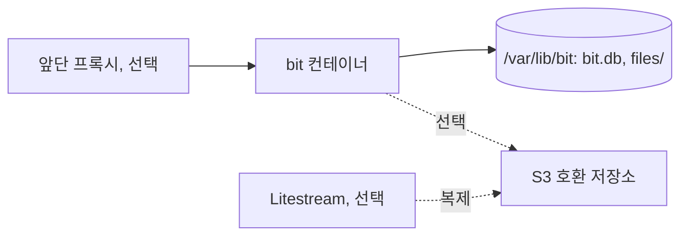

BIT는 로컬·사내·개인 서버 어디서든 컨테이너 하나로 돈다. 특정 서버·도메인을 전제하지 않는다. 배포 자동화는 나중이고(D-026), 지금은 CI 검사와 태그 이미지까지다.

## 이미지

루트의 여러 단계 `Dockerfile` 하나로 만든다. 테스트는 이미지 안에서 돌리지 않는다. CI가 먼저 돌린다.

| 단계 | 베이스 | 하는 일 |
| :--- | :--- | :--- |
| 화면 | `node:24-alpine` | `client/`에서 `npm ci` → `npm run build` |
| 서버 | `eclipse-temurin:21-jdk-alpine` | 의존성을 먼저 받아 캐시한 뒤 `bootJar` |
| 실행 | `eclipse-temurin:21-jre-alpine` | jar와 화면 `dist/`만 복사. 비루트 사용자(10001) |

- 화면과 서버는 각자 층이라 한쪽이 바뀌어도 다른 쪽 빌드는 캐시를 쓴다.
- 데이터 폴더 `/var/lib/bit`를 만들어 실행 사용자에게 준다. `DB_PATH=/var/lib/bit/bit.db`, 로컬 파일 저장소는 `/var/lib/bit/files`.
- `HEALTHCHECK`는 `/api/v1/health`를 읽는다(간격 30초, 시작 유예 60초).
- 실행: `docker run -p 8080:8080 -v bit-data:/var/lib/bit --env-file app.env bit:<태그>`

## 데이터 볼륨

볼륨 하나가 상태의 전부다. 컨테이너는 언제든 버리고 다시 띄운다.



- 파일 저장소를 S3 호환으로 바꾸면(D-029) 볼륨에는 DB만 남는다. 로컬이면 볼륨 백업을 사용자가 챙긴다.
- 비밀값은 `app.env`(권한 640)에만 두고 키 목록은 `deploy/app.env.example`이 보인다. 선택 기능 키가 비면 그 기능만 꺼진다(D-030).

## compose

환경별 compose 예시는 저장소 `deploy/` 아래에 둔다(local·dev·prod). 실제 배포는 대상 서버에 이미 있는 운영 compose를 기준으로 한다. 이 저장소의 현재 운영 서버는 **`~/apps/bit/compose.yml`**이며, 같은 디렉터리의 `app.env`와 `backups/`를 사용한다. 서비스·외부 볼륨·네트워크와 명령은 [운영 서버 배포](../../../../docs/deployment.md)를 따른다. 다른 경로에 운영 compose를 새로 만들거나 옛 수동 실행 스크립트로 교체하지 않는다.

| 항목 | 규칙 |
| :--- | :--- |
| 볼륨 | 서비스 하나에 데이터 볼륨 하나(`/var/lib/bit`) |
| 포트 | 앞단 프록시가 있으면 `127.0.0.1:<포트>`로만 연다 |
| 로그 | 컨테이너 로그를 10MB × 3개로 제한한다 |
| 재시작 | health가 실패하면 로그를 남기고 멈춘다. 자동으로 되돌리지 않는다 |

앞단 프록시는 TLS와 전달만 한다. 화면 파일과 캐시 규칙은 이미지가 정하므로 버전이 바뀌어도 프록시 설정은 고치지 않는다. 오래 열리는 이벤트 스트림(SSE) 경로는 버퍼 없이 넘긴다.

## CI (GitHub Actions)

| 시점 | 처리 |
| :--- | :--- |
| PR·main 푸시 | 바뀐 영역을 검사한다. 서버 `./gradlew check`, 화면 `npm run check`. 통과해야 병합한다 |
| `v<버전>-rc.<번호>` 태그 | 이미지를 만든다 |
| `v<버전>` 태그 | RC와 같은 커밋에 붙인다. 이미지를 만든다 |

태그는 옮기거나 다시 쓰지 않는다. 배포본은 태그와 커밋으로 식별한다. main 병합은 배포하지 않는다.

태그 이미지는 `.github/workflows/release.yml`이 `ghcr.io/dev-goraebap/better-issue-tracker`에 올린다(D-082). 태그를 다는 절차는 `bit-release` 스킬이다.

## 이미지 바꾸기 (수동)

배포 자동화 전까지 사람이 한다. 나중에 자동화해도 같은 순서를 따른다.

현재 운영 서버에서는 아래 순서를 `~/apps/bit/compose.yml`의 `app` 서비스에 적용한다. 이미지 태그는 compose에 저장해 다음 실행에도 유지되게 하고, 명령에는 `-f compose.yml`을 명시한다. 서버 Docker 경로는 `/snap/bin/docker`다. 구체적인 백업 검사와 복구 절차는 [운영 서버 배포](../../../../docs/deployment.md)를 따른다.

1. 새 태그 이미지가 호스트에 있는지 확인한다.
2. 컨테이너를 멈추고 데이터 볼륨을 `backups/<시각>-<태그>/`로 복사한다. Litestream을 쓰면 두 컨테이너를 함께 멈추고, 사본에서 Litestream 상태 폴더(`.bit.db-litestream`)를 뺀다.
3. 새 이미지로 띄우고 health를 기다린다.
4. `backups/`는 최근 5개만 남긴다.

### 되돌리기

1. 컨테이너를 멈춘다.
2. 데이터 볼륨을 되돌릴 태그 직전의 `backups/` 사본으로 바꾼다. 새 마이그레이션이 적용된 DB를 옛 이미지가 읽지 못하기 때문이다.
3. 옛 태그 이미지로 띄우고 health를 본다.

## DB 복제 (Litestream, 선택)

운영 DB를 S3 호환 저장소로 계속 복제한다. 서버가 쓴 변경은 WAL에 먼저 적히고, Litestream이 WAL 변경을 주기적으로 올리며 하루에 한 번 DB 전체 사본(스냅숏)을 올린다. 복구는 가장 가까운 스냅숏에 그 뒤 변경을 덧입혀 원하는 시각의 DB를 만든다. 쓰지 않으면 배포 직전 사본만 둔다.

| 항목 | 값 |
| :--- | :--- |
| 실행 | compose의 `litestream` 서비스. 서버와 같은 볼륨을 같은 경로(`/var/lib/bit`)로 마운트하고 같은 사용자 10001로 돈다 |
| 설정 | `deploy/<환경>/litestream.yml` |
| 복제 위치 | 버킷 안의 전용 접두사(예: `db-backups/<환경>/litestream/`) |
| 보관 | 스냅숏 24시간마다, 30일 보관(`snapshot.retention: 720h`) |
| 키 | 스토리지 주소·버킷과 `LITESTREAM_ACCESS_KEY_ID`·`LITESTREAM_SECRET_ACCESS_KEY` |

> [!IMPORTANT]
> 한 복제 위치에는 DB 하나만 복제한다. 다른 DB(dev, 복구 연습용 사본)를 같은 설정으로 `replicate`하면 복구할 수 없게 된다.

서버를 먼저 띄워 health를 기다린 뒤 Litestream을 띄운다. 키가 하나라도 비어 있으면 Litestream을 띄우지 않는다. 서버가 멈출 때 마지막 연결이 WAL을 DB에 합치므로, Litestream은 다시 뜰 때 스냅숏을 새로 올린다.

### 복제 확인

켠 직후와 그 뒤 가끔 한다. `<p>`는 compose 프로젝트 이름이다.

```bash
# Uploads and errors since the start
docker logs --tail 50 <p>-litestream
# Local position and WAL size
docker exec <p>-litestream litestream status -config /etc/litestream.yml
# Files on the bucket at every level
docker exec <p>-litestream litestream ltx -config /etc/litestream.yml -level all /var/lib/bit/bit.db
# A real restore to a scratch file, checked and removed
docker compose -p <p> -f compose.yaml run --rm --no-deps litestream \
  restore -config /etc/litestream.yml -o /var/lib/bit/restore-test.db /var/lib/bit/bit.db
docker exec <p>-litestream sqlite3 /var/lib/bit/restore-test.db \
  'PRAGMA integrity_check; SELECT count(*) FROM workItem;'
docker exec <p>-litestream rm /var/lib/bit/restore-test.db
```

`integrity_check`가 `ok`여야 한다. 볼륨은 사용자 10001의 것이라 그 안의 파일은 컨테이너 안에서 만들고 지운다.

### 복구

DB 파일이 깨졌거나 호스트를 잃었을 때 되살린다. 새 호스트라면 `compose.yaml`·`litestream.yml`·`app.env`를 먼저 둔다.

1. `docker compose -p <p> -f compose.yaml stop`으로 두 컨테이너를 멈춘다.
2. 새 파일로 복구한다. 특정 시각으로는 `-timestamp <UTC 시각>`을 더한다.
   ```bash
   docker compose -p <p> -f compose.yaml run --rm --no-deps litestream \
     restore -config /etc/litestream.yml -o /var/lib/bit/bit.restored.db /var/lib/bit/bit.db
   ```
3. 지금 `bit.db`·`-wal`·`-shm`과 상태 폴더 `.bit.db-litestream`을 `backups/<시각>-before-restore/`로 옮기고, 복구한 파일을 `bit.db`로 바꾼다. 소유자는 10001로 둔다.
4. `docker compose -p <p> -f compose.yaml up -d`로 띄우고 health와 "복제 확인"의 로그를 본다.

배포 직전 사본으로 되돌린 뒤에는 그 시점 이전으로의 시각 복구를 보장하지 않는다.

## 나중으로 미룬 것

- 배포 자동화(어느 호스트로, 어떤 방식으로). D-026.
- 비밀값 자동 생성(첫 기동 때 서버가 만들어 볼륨에 둠). 로컬 `dev.sh`는 이미 자동 생성한다.
