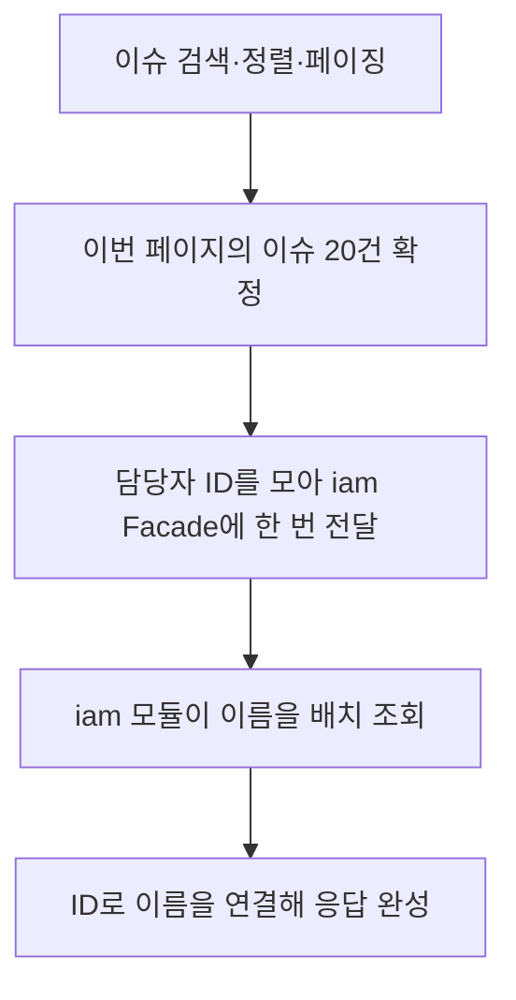

다른 모듈의 값이 화면에 필요하면, 먼저 그 값이 **목록을 고르는 조건인지, 고른 목록에 표시할 정보인지**를 구분한다. 표시 정보는 소유 모듈의 Facade로 받아 붙이고, 검색·정렬·건수를 결정하는 값은 SQL에서 함께 읽는다. 단일 DB·단일 배포인 이 프로젝트의 규칙이며, 적용 단위는 개별 쿼리다.

## 담당자 이름을 표시할 때

issue 모듈이 이슈를, iam 모듈이 사용자 이름을 관리한다. 이슈 목록에 담당자 이름을 표시할 때는 다음 순서로 조회한다. 아래 예시는 조회 방식을 설명하기 위한 것이며, 구현 완료를 뜻하지 않는다.



Facade는 다른 모듈이 사용할 수 있도록 공개한 기능이다. issue 모듈은 이름을 요청하는 방법과 반환값만 알면 된다. iam 모듈이 저장 테이블이나 컬럼을 바꿔도 계약의 입력과 반환 의미를 유지하면 호출 코드는 그대로 쓸 수 있다.

ID는 중복을 제거해 한 번에 전달한다. 이슈마다 Facade를 호출하면 20건에 이름 요청도 20번 발생한다. 목록 조회와 각 이름 조회가 SQL 한 번씩이라면 총 21번인 N+1 문제가 된다. 배치 조회를 SQL 한 번으로 구현하면 두 번으로 줄어든다. Facade 호출 횟수와 실제 SQL 횟수는 구분한다.

이 단계의 코드는 이름을 붙일 뿐, 이슈를 다시 걸러내거나 순서를 바꾸지 않는다. 이름이 없는 경우(담당자 없음, 탈퇴한 사용자)의 표시 정책도 이슈를 조용히 제외하지 않도록 정한다. 추가 조회량은 이번 페이지의 ID 범위로 제한되지만, 처리 시간은 인덱스·반환량·실행계획에 따라 달라진다.

## 담당자 이름으로 검색할 때

"김씨가 담당한 이슈 3건"을 찾는다고 하자. 이슈 3건을 먼저 읽은 뒤 김씨만 남기면, 뒤에 조건에 맞는 이슈가 있어도 한 페이지를 채우지 못한다.

| 처리 단계 | 먼저 3건을 읽고 코드에서 검색 | SQL에서 검색한 뒤 3건 선택 |
| --- | --- | --- |
| 전체 이슈 순서 | 김하나 → 이두나 → 박세나 → 김다온 → 김라온 | 동일 |
| 검색·페이징 결과 | 김하나 1건 | 김하나·김다온·김라온 3건 |
| 차이 | 김다온·김라온은 읽지 못함 | 조건에 맞는 첫 페이지 |

전체 이슈를 읽어 코드에서 검색하면 전송량과 메모리 사용량이 전체 건수에 비례한다. iam 모듈에서 김씨의 ID를 모두 받아 SQL 조건에 넣는 방법도 가능하지만, 일치하는 사용자가 많으면 전달할 ID가 커진다. 같은 DB를 사용하는 이 프로젝트에서는 양쪽 조건과 정렬을 DB에서 함께 처리하고 페이지를 선택한다.

다른 모듈의 값이 `WHERE`, `ORDER BY` 또는 전체 건수 계산에 필요하면, 해당 화면 쿼리에서 그 테이블을 직접 읽는다. `INNER JOIN`도 매칭되지 않는 이슈를 제거하므로 검색 조건의 일부다. 정렬에는 고유 ID를 포함해 같은 정렬값의 순서를 안정적으로 정한다(커서 `seek`의 마지막 기준).

직접 조회한 쿼리는 상대 테이블 구조에 의존한다. jOOQ의 생성 타입 참조는 사용처 검색과 일부 변경 오류 발견에 도움이 되지만, 상태 값의 의미가 바뀌는 것까지 컴파일러가 검사하지는 않는다. 직접 조회는 필요한 목록·검색 쿼리에 한정하며, 상세 조회까지 같은 방식으로 통일하지 않는다.

## 조인한 뒤 이슈 한 건이 몇 행인지 확인한다

이슈 한 건에 상대 행이 최대 한 건 연결되면 to-one, 여러 건 연결되면 to-many 관계다. 담당자 한 명은 to-one, 라벨·링크 목록은 to-many의 예다. to-one은 실제 조인 조건과 유일성 제약으로 최대 한 행임이 보장되어야 한다.

검색 때문에 사용자 테이블을 이미 조인했다면 이름도 같은 쿼리에서 가져온다. 별도 Facade 조회와 조립을 생략할 수 있다. 다만 표시 컬럼을 추가로 참조하는 만큼 그 컬럼 변경에도 영향을 받는다. 상대 행이 없어도 이슈를 유지해야 한다면 `LEFT JOIN`과 검색 조건의 위치를 함께 검토한다.

이슈 하나에 라벨 3개와 연결 커밋 2개가 있으면, 두 목록을 그대로 조인한 결과는 다음처럼 6행이 된다.

| 이슈 | 라벨 | 커밋 |
| --- | --- | --- |
| BIT-42 | 라벨 1 | 커밋 1 |
| BIT-42 | 라벨 1 | 커밋 2 |
| BIT-42 | 라벨 2 | 커밋 1 |
| BIT-42 | 라벨 2 | 커밋 2 |
| BIT-42 | 라벨 3 | 커밋 1 |
| BIT-42 | 라벨 3 | 커밋 2 |

`LIMIT`은 이 결과의 행을 자른다. 이슈 20건을 원해도 중복된 행 20개에서 끝날 수 있고, `COUNT(*)`도 이슈 수보다 커진다. to-many 목록이 하나여도 부모 행의 반복은 발생한다.

기본 방식은 이슈 페이지를 먼저 확정하고, 그 이슈들의 라벨과 커밋을 각각 배치 조회해 연결하는 것이다. 다른 모듈 소유의 표시 정보라면 해당 모듈의 Facade를 거친다. 이슈별로 조회를 반복하지 않는다. 여러 쿼리 사이에 데이터가 바뀔 수 있으므로 동일 시점의 결과가 필요한 화면은 트랜잭션 격리 수준을 따로 검토한다. `readOnly` 지정만으로 같은 스냅샷이 보장되지는 않는다.

`get_issue_context` 같은 MCP 맥락 묶음도 같다. 이슈를 확정한 뒤 결정·산출물·커밋·관련 이슈를 각각 배치로 모은다(`07-mcp.md`).

## 결정에서 파생된 이슈를 고르되 링크 전체를 보여줄 때

"D-007에서 파생된 이슈"은 `link`를 `EXISTS`로 확인해 이슈를 고른다. 다음 SQL은 관계를 보여주는 예시다.

```sql
SELECT w.issue_id, w.number, w.title
FROM issue w
WHERE w.project_id = :project_id
  AND w.deleted_at IS NULL
  AND EXISTS (
    SELECT 1
    FROM link l
    WHERE l.from_type = 'issue'
      AND l.from_id = w.issue_id
      AND l.relation = 'derives_from'
      AND l.to_type = 'decision'
      AND l.to_id = :decision_id
      AND l.deleted_at IS NULL
  )
ORDER BY w.number DESC, w.issue_id DESC
LIMIT 20;
```

`EXISTS`는 일치하는 행의 존재만 검사하므로 링크가 여러 개여도 이슈 행을 늘리지 않는다. 그 뒤 확정된 이슈 ID로 링크 전체를 가져온다. 검색에 사용한 링크만 응답 목록에 남기는 실수를 피할 수 있다. 실제 쿼리에는 권한·보관·삭제 조건도 적용한다.

링크 수로 검색하거나 정렬할 때(예: 결정의 "이행 2/3", D-012)는 `COUNT` 같은 집계가 부모당 값 하나를 반환하게 한다. 자식 행을 그대로 늘린 결과에 부모 페이징을 적용하지 않는다. 별도 조회 외에도 사전 집계나 JSON·jOOQ `MULTISET`으로 중첩 목록을 만드는 방법이 있다. 이는 SQL 표현 방법이며 모듈 경계의 직접 조회 허용 범위를 넓히지는 않는다. 성능은 쿼리 수만으로 단정하지 않고 실행계획, 반환량과 응답 시간을 확인한다.

## 쓰기 경로는 소유 모듈에 요청한다

조회에서 허용한 직접 읽기 예외를 명령 처리에 적용하지 않는다. 명령 중 다른 모듈의 상태 확인이나 변경이 필요하면 Facade를 사용한다. 다른 모듈의 내부 패키지를 직접 참조하지 않는 기존 규칙도 유지한다.

이슈를 보드 컬럼으로 옮길 때를 예로 들면, 그 컬럼이 완료(`is_final`)인지는 project 모듈이 소유한 값이다. issue 모듈이 `board_column` 테이블을 직접 읽어 판정하면 컬럼 해석 규칙을 다시 구현하게 된다. 소유 모듈의 Facade로 확인하면 그 규칙을 소유 모듈에서 관리할 수 있다. 링크를 만들 때 대상 존재를 확인하는 것도 같은 이유로 Facade를 거친다(D-014). Facade를 사용한다는 사실만으로 원자성이 생기지는 않으며, 함께 성공해야 하는 변경의 트랜잭션 경계는 기능 설계에서 정한다.

## 사본은 당시 값을 남길 때 사용한다

세션 참석자의 `session_participant.display_name`은 기록 당시의 이름이다. 이후 사용자가 이름을 바꿔도 회의록의 참석자 표시는 그대로여야 하므로 기록 시점에 받아 저장하고 원본 변경을 따라가지 않는다. 반면 "현재 이름"을 다른 모듈에 복사해 계속 맞추는 방식은 사용하지 않는다. 변경 경로마다 동기화해야 하고 누락되면 값이 어긋난다.

## 선택 기준과 적용 범위

| 필요한 것 | 이 프로젝트의 기본 선택 |
| --- | --- |
| 다른 모듈의 표시 정보 | 페이지 확정 후 Facade 배치 조회 |
| 다른 모듈의 값으로 검색·정렬 | 해당 화면 쿼리에서 SQL 직접 읽기 |
| 여러 자식 중 조건에 맞는 행의 존재 | `EXISTS`로 부모 선택 |
| 자식 수로 검색·정렬 | 부모당 값 하나인 집계 |
| 검색으로 이미 조인한 to-one의 표시값 | 같은 쿼리에서 가져오기 |
| 여러 자식 목록 표시 | 확정된 부모 ID로 각각 배치 조회 |
| 명령 중 다른 모듈의 상태 확인·변경 | Facade 요청 |
| 업무 처리 당시의 값 보존 | 변경을 따라가지 않는 시점 기록 |

모듈 내부 테이블끼리의 조회는 이 모듈 간 계약 규칙의 대상이 아니지만, 조인에 따른 행 수와 페이징 검토는 동일하게 적용한다. 조회를 위해 공개 DB 뷰, 사본 동기화 이벤트, 별도 보고 모듈이나 추가 ArchUnit 강제 규칙을 도입하지 않는다. 뷰는 DDL 관리가, 사본 동기화는 누락·순서·재처리 관리가 추가되므로 현재 범위에서 채택하지 않는다.

## 근거 자료

- [SQLite: LIMIT과 OFFSET](https://www.sqlite.org/lang_select.html#limitoffset): 제한 대상은 쿼리의 결과 행이다.
- [SQLite: EXISTS](https://www.sqlite.org/lang_expr.html#the_exists_operator): 일치하는 자식 수와 관계없이 부모 행을 유지하며 존재 여부를 검사한다.
- [jOOQ: MULTISET](https://www.jooq.org/doc/latest/manual/sql-building/column-expressions/multiset-value-constructor/): 자식 목록을 중첩 결과로 조회할 수 있다.

자료는 SQL 동작의 근거다. Facade를 기본으로 삼는 선택은 이 프로젝트가 저장 구조의 변경 영향을 제한하기 위해 정한 설계 규칙이다.
