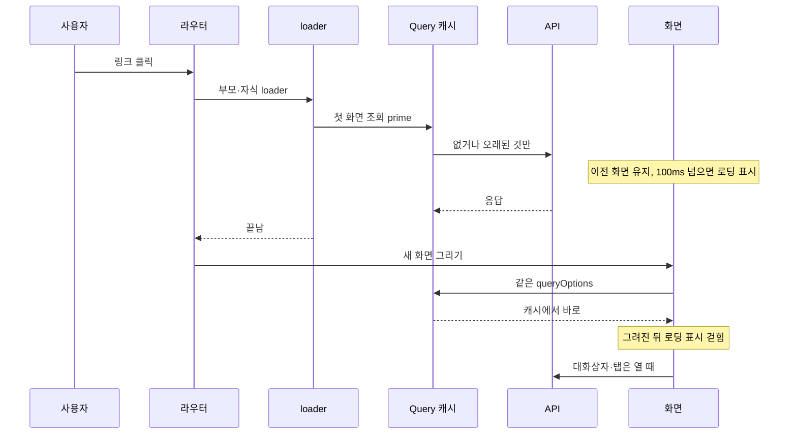

화면은 다 그려진 뒤에만 보인다. 라우트가 첫 화면의 데이터를 미리 읽는 동안 이전 화면을 두고, 기다림이 길어지면 기본 로딩 표시를 띄운다. 새 화면이 그려진 뒤에 바뀌는 것은 크기가 이미 정해진 자리 안의 사진뿐이라 레이아웃이 흔들리지 않는다.

## 첫 화면 데이터는 loader가 읽는다

페이지 슬라이스의 `api/load.ts`에 `load…` 함수를 두고 라우트의 `loader`가 부른다. 함수는 그 화면이 도착하자마자 그리는 조회를 모두 `prime`(TanStack Query `prefetchQuery`)으로 동시에 읽는다. loader는 데이터를 화면에 넘기지 않고 Query 캐시를 채운다. 화면은 같은 `queryOptions`로 `useQuery`를 불러 캐시에서 바로 그린다([데이터 흐름](03-data-flow.md)).

| 조회 | 읽는 곳 |
| :--- | :--- |
| 화면이 도착하자마자 보이는 영역(목록, 요약, 섹션, 표의 첫 쪽, 보드의 열) | 라우트 loader |
| 여러 화면이 함께 쓰는 것(세션, 켜진 기능 목록, 워크스페이스·프로젝트 목록) | 인증된 부모 라우트의 loader |
| 다른 조회의 결과로 보일지 정해지는 영역 | loader가 앞 조회를 읽은 뒤 이어서 읽는다 |
| 대화상자·탭·다음 쪽처럼 사용자가 열어야 보이는 것 | 열릴 때 그 컴포넌트가 읽는다 |

> [!IMPORTANT]
> 첫 화면에 보이는 조회를 loader에서 빠뜨리지 않는다. 빠진 영역은 화면이 보인 뒤 늦게 채워져 그 아래가 밀린다. 새 섹션을 페이지에 더하면 그 조회도 `load…`에 더한다.

신선한 캐시는 다시 읽지 않는다. 조회가 실패해도 이동은 막지 않고, 화면이 그 자리에 오류와 다시 시도를 보인다. 링크에 마우스를 올리면 loader가 먼저 돈다(`defaultPreload: 'intent'`). 부모와 자식 라우트의 loader는 함께 돈다.

## 흐름

## 화면 이동 중의 로딩 표시

이동하는 동안 이전 화면이 그대로 있다. 본문·상단 경로·문서 제목은 그려진 라우트 매치의 경로(`useShownPathname`)를 따라 새 화면이 그려지는 프레임에 함께 바뀌고, 사이드·하단 메뉴의 선택만 클릭 즉시 이동할 곳으로 옮긴다. 같은 화면에서 검색 조건만 바뀌는 것은 이동이 아니다.

| 단계 | 규칙 |
| :--- | :--- |
| 뜨기 | 기다림이 100ms를 넘으면 본문 카드 위에 기본 로딩 표시를 띄운다. 100ms 안에 끝난 이동은 표시 없이 바뀐다 |
| 머물기 | 한 번 뜨면 최소 300ms 머문다. 짧게 깜빡이지 않게 하기 위해서다 |
| 걷히기 | 새 화면이 그려진 뒤 걷는다 |
| 놓이는 곳 | 본문 카드 위. 상단 경로·사이드바·하단 바는 덮지 않는다 |

로딩 표시는 Astryx 컴포넌트와 토큰으로 그린 단순한 표시이며, 고유 그림이나 애니메이션 자산을 두지 않는다. 표시는 이미지 바이트를 기다리지 않는다. 이미지는 아래 "사진 자리"의 규칙으로 화면이 보인 뒤에도 흔들림 없이 바뀐다.

## 첫 진입

첫 진입은 보여 줄 이전 화면이 없으므로 같은 로딩 표시가 창 전체에 놓인다. 스크립트를 받기 전에는 `index.html`이 저장된 테마의 바탕색으로 빈 화면을 칠해 두어, 앱이 뜰 때 색이 번쩍이지 않게 한다. 첫 화면이 그려지면 위와 같이 걷힌다.

## 화면 안 조회

화면이 스스로 시작한 조회(탭·쪽 전환, 대화상자)는 `RequestBoundary`가 100ms 뒤 작은 로딩 표시를 제자리에 최소 300ms 보인다. 재조회는 기존 내용을 유지하고 실패 안내와 다시 시도를 둔다. 첫 조회 실패는 오류 화면, 실제 빈 결과는 빈 상태로 보인다. 서버가 404로 답한 조회와 경로 값이 형식에 맞지 않아 400으로 거절된 조회(`/decisions/abc`, 오류의 `errors` 필드가 모두 쿼리에 없는 이름)는 다시 물어도 같으므로 다시 시도 없이 찾을 수 없음 화면으로 보이며, 이미 보이던 내용이 있어도 그렇다. 찾을 수 없음 화면은 페이지의 뒤로 링크(`PageFrame`의 `back`인 `BackLink`)를 '결정 목록으로 돌아가기' 같은 주 버튼으로 두고, 뒤로 링크가 없는 화면에는 버튼을 두지 않는다. 그래서 화면은 `RequestBoundary`에 실패 여부가 아니라 조회의 오류(`query.error`)를 넘긴다. 구현하지 않은 페이지에 가상 조회나 로딩 지연을 만들지 않는다.

## 사진 자리

사진은 크기가 정해진 자리에 그린다. 아바타와 첨부 썸네일은 고정 크기 칸이고, 사진 뷰어는 업로드 때 잰 가로·세로로 비율을 잡는다. 대표색이 있으면 자리를 그 색으로 먼저 칠하고, 사진이 오면 그 위로 `--duration-medium` 동안 서서히 나타나게 한다. 대표색이 없으면 자리의 기본 모양(아바타는 그 사람의 기본 그림, 썸네일은 흐린 바탕)을 둔다. 불러오지 못한 사진은 깨진 그림 대신 기본 그림이나 파일 아이콘을 보인다.

prefers-reduced-motion에서는 로딩 표시와 사진의 전환을 생략한다.
