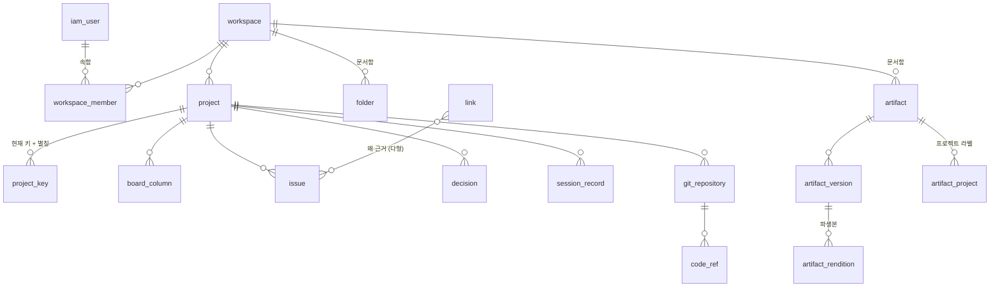

# 06. DB 스키마 (1차)

`02-domain-model.md`의 개념을 실제 테이블로 옮긴 것이다. 규칙은 `conventions.md` 5절(SandboxHr DB 규칙)을 따른다.
전체 도메인의 계획 스키마다. 실제 구현은 V1(인증 5개), V2(워크스페이스·멤버·초대 3개)까지이며 나머지는 후속 작업이다. 이미 적용한 마이그레이션은 바꾸지 않는다. 표기한 타입은 SandboxHr 스키마와 같은 타입 이름이다.

> 2026-10-22 작성. 이 문서를 쓰면서 정한 것은 맨 아래 "이 문서에서 정한 것"과 D-020, D-021에 있다.

## 공통 규칙 (요약)

| 항목 | 규칙 |
|---|---|
| 테이블 | 단수 snake_case. 인증 계열만 `iam_` 접두사 |
| 기본 키 | `<table>_id`, 값은 앱이 만드는 10자 ID `[A-Za-z][A-Za-z0-9]{9}`(D-083). V1~V8의 열은 타입 이름 `uuid`가 남아 있다. 제약 `<table>_pkey` |
| 이름 | FK `<t>_<col>_<ref>_<refcol>_fk`, 고유 `ux_`, 인덱스 `ix_`, CHECK `ck_` |
| 순간 | `timestamptz` — UTC 텍스트, 소수 6자리 고정 |
| 참거짓 | `boolean` — `1`/`0` |
| 감사 열 | 아래 표의 "감사" = `created_at`, `created_by`, `updated_at`, `updated_by`, `deleted_at`, `deleted_by` |
| 소프트 삭제 | `deleted_at` 하나. 고유 제약은 `WHERE deleted_at IS NULL` 부분 인덱스 |
| 열거값 | `varchar` + CHECK. 값은 소문자 snake_case |
| 본문 | Markdown 글자는 `text` |

SQLite 고유 인덱스는 NULL을 서로 다른 값으로 본다. NULL이 들어갈 수 있는 열로 고유를 걸 때는 `coalesce(col, '')` 식 인덱스를 쓴다.

## 개요

`link`, `activity`, `comment`는 대상 종류가 여럿이라 DB FK가 없다(D-014, D-020). 그림의 마지막 줄은 그 관계를 대표로 하나만 그린 것이다.

---

## 1. iam — 인스턴스와 인증

| 테이블 | 열 | 제약·인덱스 |
|---|---|---|
| `iam_user` | `iam_user_id`, `email varchar(256)`, `name varchar(64)`, `avatar_blob_id uuid?`, `is_instance_admin boolean`, 감사 | `ux_iam_user_email` (deleted_at IS NULL) |
| `iam_session` | `iam_session_id`, `iam_user_id`, `token_hash varchar(128)`, `active_workspace_id uuid?`, `expires_at`, `absolute_expires_at`, `last_seen_at`, `created_at` | `ux_iam_session_token_hash` |
| `iam_api_key` | `iam_api_key_id`, `iam_user_id`, `name varchar(64)`, `agent_name varchar(64)?`, `prefix varchar(16)`, `key_hash varchar(128)`, `last_used_at?`, `expires_at?`, `revoked_at?`, `created_at` | `ux_iam_api_key_key_hash` |
| `iam_password` | `iam_user_id` (PK이자 FK), `password_hash varchar(256)`, `failed_count integer`, `locked_until?`, `changed_at`, `must_change boolean` | — |
| `iam_email_otp` | `iam_email_otp_id`, `email`, `purpose varchar(16)`, `code_hash varchar(128)`, `attempt_count integer`, `expires_at`, `consumed_at?`, `created_at` | `ix_iam_email_otp_email_created_at`, `ck_..._purpose` (sign_in, password_reset) |

- **첫 관리자**: 첫 가입자가 `is_instance_admin = 1` (Kaneo 방식, D-009). 가입 트랜잭션 안에서 "관리자가 없으면 나를 관리자로"를 처리한다.
- **에이전트**: 별도 계정이 아니라 사람의 API 키로 움직인다. 키에 `agent_name`(예: `codex`, `claude-code`)을 적어 두면 기록에 남는다 (D-021).
- **로그인(D-027)**: 이메일 + 비밀번호가 기본이다. 비밀번호는 Spring Security `DelegatingPasswordEncoder` 기본(bcrypt)으로 해시해 `iam_password`에 둔다.
  연속 5회 실패하면 15분 잠근다. 메일 서버(SMTP)를 설정했을 때만 `iam_email_otp`로 OTP 로그인과 비밀번호 재설정 메일을 쓴다(SandboxHr OTP 규칙: 6자리, 5분, 5회).
  메일 서버가 없으면 인스턴스 관리자가 임시 비밀번호를 발급하고 `must_change = 1`로 둔다.

## 2. workspace

| 테이블 | 열 | 제약·인덱스 |
|---|---|---|
| `workspace` | `workspace_id`, `name varchar(64)`, `slug varchar(64)`, 감사 | `ux_workspace_slug` |
| `workspace_member` | `workspace_member_id`, `workspace_id`, `iam_user_id`, `role varchar(16)`, `joined_at` | `ux_workspace_member_workspace_id_iam_user_id`, `ck_workspace_member_role` (owner, admin, member, viewer) |
| `workspace_invitation` | `workspace_invitation_id`, `workspace_id`, `email`, `role`, `token_hash`, `status varchar(16)`, `expires_at`, `invited_by`, `created_at` | `ck_..._status` (pending, accepted, revoked, expired) |
| `label` | `label_id`, `workspace_id`, `name varchar(32)`, `color varchar(7)`, `is_system boolean`, `system_key varchar(32)?`, `version bigint`, 감사 | `ux_label_workspace_id_name` (workspace_id, lower(name), deleted_at IS NULL), `ux_label_workspace_id_system_key` (system_key IS NOT NULL) |
| `issue_view` | `issue_view_id`, `workspace_id`, `owner_id`, `is_personal boolean`, `name varchar(64)`, `description varchar(200)?`, `icon varchar(32)`, `color varchar(7)`, `layout varchar(16)`, `filters text`(JSON 객체), `sort_key varchar(16)`, `sort_direction varchar(4)`, `columns text`(JSON 배열), `position real`, `version bigint`, 감사 | `ix_issue_view_workspace_id_position`, `ck_..._layout` (list, calendar, board, timeline, cards, history), `ck_..._sort_key` (updated, created, priority, title) |
| `issue_view_tweak` | (`workspace_id`, `iam_user_id`, `view_key varchar(40)`) 기본 키, `tweak text`(JSON 객체), `updated_at` | `ix_issue_view_tweak_workspace_id_view_key` |

- 역할 4개는 고정값이다. Kaneo의 워크스페이스별 사용자 정의 역할(`workspace_role`)과 멤버별 프로젝트 접근 제한은 1차에 넣지 않는다.
- 라벨은 워크스페이스에 한 벌만 두고 이슈와는 연결표로 잇는다. Kaneo처럼 작업마다 사본 행을 만들지 않는다 (D-009).

### T-003 실제 V2 계약 (D-040~D-043)

- `workspace`: 이름 trim 후 1~64자, slug trim·소문자·ASCII 영문/숫자/하이픈 2~64자. slug는 전체 행에서 고유하며 생성 후 고정·삭제 후에도 예약한다. `updated_by_agent varchar(64)?`를 추가한다.
- `workspace_member`: `(workspace_id, iam_user_id)` 고유, 역할 CHECK, owner에 대한 workspace 부분 고유 인덱스. 생성·역할 변경·이전·제거의 트랜잭션 끝에서 owner가 정확히 한 명인지 검사한다. 조회 인덱스는 사용자→공간, 공간→가입 시각/멤버 ID다.
- `workspace_invitation`: `token_hash varchar(128)`, `accepted_by/at`, `revoked_by/at`를 포함한다. 역할 admin/member/viewer와 네 상태를 CHECK로 제한하고 accepted/revoked는 해당 기록을 요구한다. token_hash 전체 고유, `(workspace_id,email)`은 status=pending 부분 고유다. 목록 인덱스는 공간/생성 시각/ID, 권한 변화 정리는 공간/초대자다.
- 만료는 expires_at 경계에서 바로 판정하며 목록도 유효 상태를 반환한다. 재초대 쓰기에서 만료 pending을 expired로 정리한다. 원문 토큰은 저장하지 않는다.
- IAM 테이블은 다시 만들지 않는다. `iam_session.active_workspace_id, iam_user_id` 인덱스만 추가한다. 선택 포인터는 FK나 접근권의 근거가 아니며 제거·탈퇴·삭제 시 정리한다.
- V2 외래키는 IAM 사용자·workspace에 걸고, 목록은 SQL에서 필터·권한·size+1을 적용한다. 실제 정의는 `server/src/main/resources/db/migration/V2__workspace_membership_invitations.sql`이 기준이다.

## 3. project

| 테이블 | 열 | 제약·인덱스 |
|---|---|---|
| `project` | `project_id`, `workspace_id`, `name varchar(64)`, `icon varchar(32)?`, `color varchar(7)?`(V7, 둘 다 없으면 키 첫 글자), `description text?`, `position integer`, `last_issue_number bigint`, `last_decision_number bigint`, `last_session_number bigint`, `archived_at?`, `version bigint`, 감사 | `ix_project_workspace_id` |
| `project_member` | `project_member_id`, `project_id`, `workspace_id`, `iam_user_id`, `created_at`, `created_by` (V8, D-075: 소속 표시일 뿐 권한을 주지 않는다) | `ux_project_member_project_id_iam_user_id`, `ix_project_member_workspace_id_iam_user_id` |
| `project_key` | `project_key_id`, `project_id`, `workspace_id`, `key varchar(10)`, `is_current boolean`, `created_at` | `ux_project_key_workspace_id_key` (모든 행), `ux_project_key_project_id_current` (is_current = 1), `ck_project_key_key` (대문자·숫자, 2~10자) |
| `board_column` | `board_column_id`, `project_id`, `name varchar(32)`, `position integer`, `color varchar(7)?`, `is_final boolean`, `category varchar(8)`, `version bigint`, 감사 | `ix_board_column_project_id_position`, `ck_..._category` (todo, doing, done) |

- **프로젝트 키(D-011)**: 현재 키와 옛 키(별칭)를 한 테이블에 둔다. 워크스페이스 안에서 `key`가 모든 행에 걸쳐 고유하므로, 별칭으로 쓰인 키를 다른 프로젝트가 가져가는 것을 DB가 막는다. 키를 바꾸면 기존 행의 `is_current`를 0으로 내리고 새 행을 넣는다.
- **번호**: 이슈·결정·세션 번호는 프로젝트별로 1부터 증가한다. 새 번호는 `last_*_number`를 증가시켜 받는다(쓰기 잠금 안에서 처리, SQLite `BEGIN IMMEDIATE`).
- **보드 컬럼**: 프로젝트를 만들 때 할 일(todo) / 진행 중(doing) / 검토 중(doing) / 완료(`is_final`, done) 4개를 넣는다 (Kaneo 기본값).
- **상태 분류(T-006)**: `category`는 프로젝트마다 다른 컬럼을 전체 칸반에서 묶는 기준이다. 완료 컬럼(`is_final`)은 언제나 done이고, 나머지 컬럼은 셋 중 아무것이나 된다. 백로그(`board_column_id` NULL)는 분류가 없다.

## 4. issue

| 테이블 | 열 | 제약·인덱스 |
|---|---|---|
| `issue` | `issue_id`, `project_id`, `number bigint`, `title varchar(200)`, `description text?`, `board_column_id uuid?`, `position real`, `priority varchar(8)?`, `trigger_type varchar(16)?`, `assignee_id uuid?`, `start_date date?`, `due_date date?`, `closed_at?`, `archived_at?`, `version bigint`, 감사 | `ux_issue_project_id_number`, `ix_issue_board_column_id_position`, `ck_..._priority` (low, medium, high, urgent), `ck_..._trigger_type` (request, finding, external, improvement, planned) |
| `issue_label` | `issue_label_id`, `issue_id`, `label_id`, `created_at`, `created_by`, `created_by_agent?` | `ux_issue_label_issue_id_label_id`, `ix_issue_label_label_id_issue_id` |

- **상태는 컬럼 하나로**: `board_column_id`가 NULL이면 백로그다. Kaneo처럼 상태 문자열과 컬럼 ID를 함께 두지 않는다 (D-009).
- **`closed_at`**: `is_final` 컬럼으로 옮길 때 채우고, 다른 컬럼으로 나오면 비운다. 결정의 "이행 2/3" 계산(D-012)이 이 값을 센다.
- **이슈 키**는 저장하지 않고 `project_key`(현재 키) + `number`로 만든다. 웹훅 파싱은 현재 키와 별칭을 모두 찾는다.
- **이슈끼리의 관계**(blocks, subtask 등)는 `link`에 둔다 (D-014).
- 1차에 넣지 않는 Kaneo 기능: 시간 기록(`time_entry`), 사용자 정의 필드, 상태 자동 이동 규칙(`workflow_rule`).

### T-004 실제 V3 계약

- V3에 project / project_key / board_column / work_item(V10에서 `issue`로 바뀜)을 추가했다. V1/V2는 수정하지 않는다. 작업 번호는 bigint이며 프로젝트 카운터와 같은 쓰기 트랜잭션에서 발급한다.
- 프로젝트·컬럼·작업에 version을 둔다. 새 감사 열에는 생성·수정·삭제의 사용자와 에이전트 이름을 함께 둔다. archived_at과 deleted_at은 별개다.
- (project_id, workspace_id) 복합 키를 project_key가 참조해 다른 공간의 키 연결을 거부한다. (project_id, board_column_id) 복합 키를 issue가 참조해 다른 프로젝트의 컬럼 연결을 거부한다.
- project_key는 삭제 여부와 무관하게 공간 내 고유하며, 프로젝트당 현재 키는 부분 인덱스로 최대 하나다. 생성·키 전환 서비스가 현재 키의 존재를 보장한다.
- issue_label과 라벨 테이블은 라벨 구현 때 새 마이그레이션으로 추가한다. 프로젝트/작업 REST·화면·보드 이관 검증 전체가 끝난 상태는 아니다. 진행 결과는 T-004 지시서를 따른다.

## 5. decision / session

| 테이블 | 열 | 제약·인덱스 |
|---|---|---|
| `decision` | `decision_id`, `project_id`, `number integer`, `title varchar(200)`, `body text`, `rejected_alternatives text?`, `status varchar(16)`, `trigger_type varchar(16)?`, `accepted_at?`, `superseded_at?`, 감사 | `ux_decision_project_id_number`, `ck_..._status` (proposed, accepted, superseded) |
| `session_record` | `session_record_id`, `project_id`, `number integer`, `type varchar(16)`, `title varchar(200)`, `occurred_at`, `summary text`, 감사 | `ux_session_record_project_id_number`, `ck_..._type` (meeting, agent_session) |
| `session_participant` | `session_participant_id`, `session_record_id`, `kind varchar(8)`, `iam_user_id uuid?`, `display_name varchar(64)`, `created_at` | `ck_..._kind` (user, agent, guest) |

- `body`에는 "무엇을 / 왜", `rejected_alternatives`에는 "기각한 대안과 이유"를 Markdown으로 쓴다. 대안을 행 단위로 쪼개지 않는다.
- 결정의 출처(세션), 대체(결정 → 결정), 파생 이슈는 모두 `link`다 (D-014).
- 이행 진행은 저장하지 않고 계산한다 (D-012).
- 테이블 이름이 `session`이 아닌 이유: 로그인 세션(`iam_session`)과 헷갈리지 않게.
- 표시 번호: 프로젝트 안에서 `D-007`, `S-003`. 다른 프로젝트 것을 가리킬 때는 `BIT D-007`처럼 프로젝트 키를 앞에 붙인다.

### T-005 실제 V4 계약 (기반 구현 중)

- `decision`과 `session_record`는 `version bigint`를 갖는다. 번호의 `(project_id, number)` 고유 제약은 soft delete 여부와 무관하다. accepted/superseded 상태와 최초 시각의 조합을 DB CHECK로 검사한다.
- `session_participant`는 같은 세션의 user ID 중복을 DB에서 막는다. user는 ID 필수, guest/agent는 ID 없음이며 표시 이름은 스냅샷이다.
- `link`의 활성 edge는 workspace까지 묶어 고유하며 relates_to의 양쪽 순서를 정규화한다. 대체될 결정당 대체자 하나, subtask당 부모 하나는 부분 고유 인덱스로 보호한다. 관계별 허용 타입과 자기 연결 금지도 CHECK로 검사한다. 그래프 순환·현재 권한·대상 존재는 서비스의 책임이다.
- `comment`에 workspace_id/version과 표준 생성·수정·삭제 agent 감사 열을 추가한다. 응답의 authorAgent는 created_by_agent에서 읽으며 같은 값을 별도 열로 중복 저장하지 않는다.
- `activity`는 payload의 JSON 유효성과 UTF-8 128KiB 상한을 검사하고 workspace/project 복합 소속 FK를 둔다. target ID에는 다형 FK를 두지 않는다. 조회의 삭제 대상 숨김과 업무 변경 원자 기록은 후속 서비스 단계에서 연결한다.
- V4 기반 스키마와 순수 도메인은 T-005 전체 완료를 뜻하지 않는다. 공개 업무 Facade·저장소·REST·화면 및 통합 게이트는 작업 지시서에 따라 이어서 구현한다.

### T-006 실제 V5 계약 (`V5__labels_column_category.sql`)

- `label`: 이름은 trim 후 1~32자이고 공간 안에서 대소문자를 가리지 않고 고유하다(삭제된 행 제외, `lower(name)` 부분 인덱스). 색은 `#RRGGBB`이며 서버가 소문자로 저장한다. `is_system=1`이면 `system_key`가 있어야 하고 아니면 없어야 하며, `system_key`는 공간당 하나다. 시스템 라벨은 삭제 표시를 할 수 없다(CHECK). 결정기록 라벨은 `system_key='decision'`, 이름 `결정기록`, 색 `#5e6ad2`다.
- V5는 기존 워크스페이스마다 결정기록 라벨을 하나씩 넣는다(만든 사람은 그 워크스페이스의 `created_by`). 새 워크스페이스는 생성 트랜잭션 안에서 같은 라벨을 받는다.
- `issue_label`: 이슈·라벨 FK, `(issue_id, label_id)` 고유. 라벨이 삭제되어도 연결 행은 남고 응답·필터에서만 빠진다. 다른 워크스페이스 라벨 연결은 서비스가 거부한다(DB는 공간 일치를 검사하지 않는다).
- `board_column.category`: `ALTER TABLE ADD COLUMN`(기본값 doing)으로 더하고 기존 행을 채운다. 완료 컬럼은 done, 프로젝트마다 지우지 않은 비완료 컬럼 중 position이 가장 앞인 것은 todo, 나머지는 doing이다. 완료→done 규칙은 열 하나짜리 CHECK로 걸 수 없어(ADD COLUMN이 기존 행에 CHECK를 바로 검사) 도메인이 지킨다.

### T-006 실제 V6 계약 (`V6__issue_views.sql`)

- `issue_view`: 뷰(D-066·D-068). `is_personal=0`이면 워크스페이스 모두에게, 1이면 `owner_id`에게만 보인다. `filters`는 status·priority·assignee·label 키만 쓰는 JSON 객체(4,000자 이하, 값은 화면이 정하는 쉼표 문자열이라 서버는 키와 길이만 검사), `columns`는 표시 속성 JSON 배열(500자 이하)이다. JSON CHECK는 `json_valid`가 거짓이면 `json_type`을 부르지 않도록 CASE로 쓴다(깨진 JSON이 오류가 아니라 제약 위반이 되게).
- 기본 뷰 '전체 이슈'는 저장하지 않는다. V6은 기존 워크스페이스마다 백로그·진행 보드·캘린더·결정기록 공용 뷰 넷을 position 0~3으로 넣는다(주인은 워크스페이스의 `created_by`). 새 워크스페이스는 생성 트랜잭션 안에서 같은 넷을 받는다.
- `issue_view_tweak`: 사람별 조정(보기 방식·정렬·표시 속성). `view_key`는 뷰 ID(소문자 표준 표기)나 `all`이라 FK가 없다. 뷰를 지우면 그 뷰의 조정 행을 모두 지운다. 남의 개인 뷰가 된 뷰의 조정은 행은 남기고 조회에서 뺀다.

## 6. artifact — 문서함

| 테이블 | 열 | 제약·인덱스 |
|---|---|---|
| `folder` | `folder_id`, `workspace_id`, `parent_folder_id uuid?`, `name varchar(128)`, 감사 | `ux_folder_workspace_id_parent_name` (coalesce(parent_folder_id,''), name, deleted_at IS NULL) |
| `artifact` | `artifact_id`, `workspace_id`, `folder_id uuid?`, `title varchar(200)`, `description text?`, `kind varchar(8)`, `doc_id varchar(32)?`, `source_type varchar(16)`, `git_repository_id uuid?`, `git_path varchar(512)?`, `git_branch varchar(128)?`, 감사 | `ux_artifact_workspace_id_doc_id` (doc_id IS NOT NULL, deleted_at IS NULL), `ck_..._kind` (file, managed), `ck_..._source_type` (upload, markdown, git), `ck_..._git` (source_type = git이면 git 열 필수) |
| `artifact_project` | `artifact_project_id`, `artifact_id`, `project_id`, `created_at` | `ux_artifact_project_artifact_id_project_id` |
| `artifact_version` | `artifact_version_id`, `artifact_id`, `status varchar(16)`, `version_label varchar(16)?`, `blob_id uuid?`, `git_commit_sha varchar(40)?`, `git_ref varchar(128)?`, `change_summary text?`, `released_at?`, `released_by?`, 감사 | `ux_artifact_version_artifact_id_open` (status IN (current, draft)), `ck_..._status` (current, draft, released, superseded) |
| `artifact_rendition` | `artifact_rendition_id`, `artifact_version_id`, `kind varchar(8)`, `blob_id uuid?`, `status varchar(8)`, `converter varchar(64)?`, `error_message text?`, `created_at`, `updated_at` | `ux_artifact_rendition_version_id_kind`, `ck_..._kind` (text, pdf), `ck_..._status` (pending, done, failed) |

- **1차(D-019)**: `kind`는 항상 `file`, `doc_id`는 비어 있다. 산출물마다 `artifact_version` 행이 하나(`status = current`)이고, 다시 올리면 그 행을 덮어쓴다(이전 blob은 정리 대상).
- **관리 문서(이후)**: `status`가 `draft → released → superseded`로 쓰인다. 열린 행(current 또는 draft)은 산출물당 하나라 D-013(초안 한 칸)을 DB가 지킨다. 열과 인덱스는 1차부터 만들어 두므로 테이블을 쪼개는 마이그레이션이 필요 없다.
- **정본(D-016)**: 업로드·플랫폼 Markdown이면 `blob_id`, Git이면 `git_commit_sha`(+ 확정 시 `git_ref`). 1차의 Git 정본은 추적 브랜치의 최신 커밋을 `current` 행에 갱신한다.
- **파생본**: 텍스트 변환·PDF는 `artifact_rendition`. 변환은 트랜잭션 밖 작업이 만들고 상태만 갱신한다. `converter`에 도구와 버전을 남겨, 도구가 바뀌면 다시 만들 수 있게 한다.
- **개정 사유**는 열이 아니라 `link`(이슈/결정 `revises` 산출물)다. 변경 요약은 사람이 쓰는 글이라 열로 둔다.
- 폴더 `folder_id`가 NULL이면 문서함 맨 위에 있다.

## 7. coderef — Git 참조

| 테이블 | 열 | 제약·인덱스 |
|---|---|---|
| `git_repository` | `git_repository_id`, `project_id`, `provider varchar(8)`, `url varchar(512)`, `external_id varchar(128)`, `default_branch varchar(128)`, `webhook_secret_hash varchar(128)`, `read_token_encrypted text?`, `read_token_expires_at?`, 감사 | `ux_git_repository_project_id_url`, `ck_..._provider` (github, gitlab, gitea) |
| `code_ref` | `code_ref_id`, `git_repository_id`, `kind varchar(16)`, `external_id varchar(128)`, `title text?`, `author_name varchar(128)?`, `author_email varchar(256)?`, `url varchar(512)`, `state varchar(16)?`, `occurred_at`, `created_at`, `updated_at` | `ux_code_ref_repository_id_kind_external_id`, `ix_code_ref_repository_id_occurred_at`, `ck_..._kind` (commit, merge_request, branch) |

- 프로젝트 하나에 저장소 여러 개를 붙일 수 있다 (Kaneo는 1개).
- **커밋 단위로 기록한다**: push 웹훅의 커밋마다 `code_ref` 행을 만들고, 메시지에서 이슈 키를 찾아 `link`(`implements`)를 만든다. `external_id`는 커밋이면 SHA, MR이면 번호, 브랜치면 이름.
- **Git 정본 읽기(D-028)**: 연결할 때 읽기 전용 토큰을 받아 `read_token_encrypted`에 암호화해 둔다(키는 첫 실행 때 생성하는 비밀값).
  커밋 웹훅이 오면 그 저장소를 정본으로 쓰는 산출물의 경로가 바뀌었는지 보고, 바뀐 md만 호스팅 API로 받는다. 만료 7일 전부터 화면에 알린다.

## 8. link · activity · comment — 대상이 여럿인 테이블

| 테이블 | 열 | 제약·인덱스 |
|---|---|---|
| `link` | `link_id`, `workspace_id`, `from_type varchar(16)`, `from_id uuid`, `to_type varchar(16)`, `to_id uuid`, `relation varchar(16)`, `artifact_version_id uuid?`, `anchor varchar(128)?`, `created_at`, `created_by`, `created_by_agent varchar(64)?`, `deleted_at?`, `deleted_by?` | `ux_link_edge` (from_type, from_id, to_type, to_id, relation, coalesce(artifact_version_id,''), deleted_at IS NULL), `ix_link_from`, `ix_link_to`, `ck_link_type` (issue, decision, session_record, artifact, code_ref), `ck_link_relation` |
| `activity` | `activity_id`, `workspace_id`, `project_id uuid?`, `target_type varchar(16)`, `target_id uuid`, `type varchar(32)`, `actor_id uuid?`, `actor_agent varchar(64)?`, `payload jsonb?`, `occurred_at` | `ix_activity_target` (target_type, target_id, occurred_at), `ix_activity_project_id_occurred_at` |
| `comment` | `comment_id`, `target_type varchar(16)`, `target_id uuid`, `body text`, `author_agent varchar(64)?`, 감사 | `ix_comment_target` (target_type, target_id, created_at) |

- **relation 값**: `derives_from`(결정←세션, 이슈←결정), `implements`(커밋→이슈), `revises`(이슈/결정→산출물), `based_on`(이슈→근거 산출물), `supersedes`(결정→결정), `blocks`, `relates_to`, `subtask_of`(이슈↔이슈).
- **방향**: 화살표는 "뒤에 생긴 것 → 앞선 것" 쪽으로 저장한다. 예: `D-007 derives_from S-003`, `abc123 implements BIT-42`.
- **산출물 링크(D-019)**: `to_type = artifact`. 1차에는 `artifact_version_id`·`anchor`가 비어 있고, 관리 문서가 생기면 채운다.
- **대상 존재 검사**는 link 모듈이 만들 때 한다. 대상이 소프트 삭제되면 링크는 남기고 조회에서 숨긴다 (D-014).
- **activity / comment(D-020)**: 이슈뿐 아니라 결정·세션·산출물에도 붙는다. 연결 타임라인은 `activity`와 `link`를 시간순으로 합쳐 그린다.
- **에이전트 표시(D-021)**: 사람 ID(`created_by`, `actor_id`)와 함께 API 키의 `agent_name`을 `*_agent` 열에 남긴다. 화면에는 "홍길동 (codex)"처럼 보인다.

## 9. file — 파일 저장 (SandboxHr `file` 모듈을 그대로)

`blob`, `attachment`(`owner_type`, `owner_id`, `name`, `position`), `pending_upload`를 SandboxHr `V1__schema.sql`에서 옮긴다.
- 산출물 정본과 파생본은 `artifact_version.blob_id`, `artifact_rendition.blob_id`로 `blob`을 직접 가리킨다.
- 이슈 설명·댓글에 붙는 이미지 등은 `attachment`로 붙인다.
- 업로드 흐름(사전 서명 PUT → 확정 → 크기·MIME 검증), 고아 blob 정리 배치도 SandboxHr와 같다.

## 10. notification (최소)

| 테이블 | 열 | 제약·인덱스 |
|---|---|---|
| `notification` | `notification_id`, `recipient_id`, `workspace_id`, `type varchar(32)`, `target_type varchar(16)`, `target_id uuid`, `payload jsonb?`, `read_at?`, `created_at` | `ix_notification_recipient_id_read_at_created_at` |

Kaneo 메뉴의 Inbox를 위한 최소 구성이다. 알림 설정 테이블은 1차에 넣지 않는다.

---

## 1차에 만들지 않는 것

| 무엇 | 언제 |
|---|---|
| 소셜 로그인 (GitHub OAuth 등) | 필요해지면 |
| 관리 문서 동작 (열은 있음) | 이후 (D-019) |
| baseline (릴리스 기준선) | 이후 |
| 팀 모드: 편집 잠금, 검토 승인, 멤버별 프로젝트 접근 제한 | 이후 |
| Kaneo의 time_entry, custom_field, workflow_rule, workspace_role, team | 필요해지면 |
| 프로젝트별 문서함 | 이후 (D-015) |

## 이 문서에서 정한 것

관례를 따르거나 앞선 결정에서 바로 나오는 것은 따로 묻지 않고 정했다. 바꾸고 싶으면 이 목록에서 고르면 된다.

| 항목 | 정한 것 | 근거 |
|---|---|---|
| 프로젝트 키와 별칭 | 테이블 하나(`project_key`)에 `is_current`로 구분 | 별칭 포함 고유를 DB가 지킴. D-011의 "별칭 테이블"을 구현한 형태 |
| 백로그 | `board_column_id` NULL | 상태를 한 곳에만 두기 (D-009) |
| 결정·세션 번호 | 프로젝트별 증가, `D-007`/`S-003` 표시 | 이슈 번호와 같은 방식 |
| 관리 문서용 열 | 1차부터 만들고 비워 둠 | D-019 |
| 열린 버전 한 칸 | 부분 고유 인덱스 | D-013 |
| activity·comment 대상 일반화 | D-020 | |
| 에이전트 표시 | D-021 | |
| 1차 제외 Kaneo 기능 | 위 표 | "가벼움 유지" |
