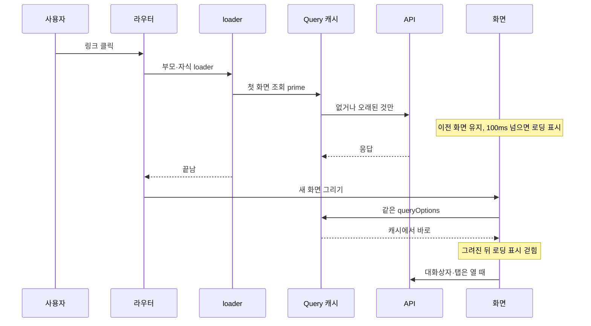

# URL·서버 상태·입력 초안 분리

필터·탭·상세·폼 상태를 다루는 화면에 적용합니다.

## 규칙과 이유

서버 데이터는 Query, 확정된 검색/선택은 Router, 저장 전 초안은 로컬 상태가 소유합니다. 파생값을 state에 복제해 Effect로 맞추지 않습니다. 읽기 키에는 응답을 바꾸는 범위·조건을 포함하고 signal을 전달합니다.

## BIT 실제 코드

현재 코드 발췌: `client/src/entities/project/api/project.ts` · 12행부터. 주변 선언·호출부는 원본에서 확인합니다.

```ts
export const projectsQuery = (w: string, status: ProjectStatus = 'active', q = '') => infiniteQueryOptions({
  queryKey: ['workspace', w, 'projects', status, q], initialPageParam: undefined as string | undefined,
  queryFn: ({ pageParam, signal }) => { const params = new URLSearchParams({ status, q, size: '50', sort: 'position', direction: 'ASC' }); if (pageParam) params.set('cursor', pageParam); return readJson<components['schemas']['Projects']>(`${projectBase(w)}?${params}`, signal); },
  getNextPageParam: page => page.nextCursor ?? undefined, retry: false,
});
```

공간·상태·검색어가 키에 있고 pageParam은 다음 요청의 cursor로 사용합니다. 같은 서버 응답을 내는 파라미터 집합이 키와 일치해야 다른 공간·필터의 자료가 섞이지 않습니다. URL 파서는 허용값만 남기고 라우트에서 ownSearch로 감쌉니다.

## 피해야 할 예

아래는 실패 이유를 보여 주는 설명용 반례이며 현재 BIT 구현의 발췌가 아닙니다. 생략된 선언이 있어 그대로 실행하는 완성 코드가 아닙니다.

```ts
const [rows, setRows] = useState(query.data);
useEffect(() => setRows(query.data), [query.data]);
// 같은 state를 입력 초안으로 쓰면 재조회가 편집을 덮을 수 있음
```

## 예외와 적용 한계

입력 초안 초기화는 대상 전환/편집 시작의 수명에 맞게 명시합니다. 외부 구독·DOM·타이머를 동기화하는 Effect는 필요할 수 있으며 정리를 포함합니다. 모든 useEffect를 금지하는 규칙은 아닙니다.

## 검증 기준

자동: client check의 타입·HTTP·라우트 검색 테스트를 실행합니다.

수동: 필터 변경·뒤로가기·공간 전환·재조회 중 입력·닫고 재열기에서 상태 소유권을 확인합니다. 타입 검사만으로 초안 손실이나 오래된 캐시 노출을 잡지 못합니다.

## 적용 절차

실제 변경은 [개발 매뉴얼의 작업 절차](../development/F8ID8dxSdL.md)로 이어 갑니다.

## 근거와 적용 기준

앱 버전은 server/build.gradle과 client/package.json 기준 0.22.0입니다. 개발 커밋은 출시 버전과 구분합니다. 근거 링크는 현재 체크아웃의 원본이며, 실제 코드 발췌는 공백을 정규화해 대조했습니다. 실행 검사 이력은 BIT-148을 따르며 이 정적 검수는 새 실행/화면 검증을 뜻하지 않습니다.

- [client/src/entities/project/api/project.ts](../../../client/src/entities/project/api/project.ts)
- [client/src/shared/lib/route-search/index.ts](../../../client/src/shared/lib/route-search/index.ts)
- [client/src/pages/workspace/projects/model/search.ts](../../../client/src/pages/workspace/projects/model/search.ts)
- [client/src/pages/project/manuals/ui/ManualWorkspace.tsx](../../../client/src/pages/project/manuals/ui/ManualWorkspace.tsx)

## 상세 적용 기준: 프론트엔드 03. 데이터 흐름


이 문서는 프론트엔드의 상태 소유권 분리, TanStack Query와 TanStack Router의 연계, 데이터 변경(Mutation)과 캐시 무효화 정책, 켜진 기능 처리, 보안 및 대량 데이터 처리 표준을 정의한다.

---

## 1. 상태 소유권(State Ownership) 분리

애플리케이션의 모든 상태는 성격과 수명주기에 따라 적합한 관리 주체에 명확히 귀속시킨다.

| 상태 분류 | 관리 주체 | 관리 대상 예시 |
| :--- | :--- | :--- |
| **서버 상태** | TanStack Query | 원격 API 조회 데이터, 캐시, 백그라운드 동기화 상태, 켜진 기능 목록 |
| **라우트 상태** | TanStack Router | URL 경로, 확정된 검색 필터, 정렬 조건, 현재 페이지 번호, 활성 탭 |
| **UI 및 입력 상태** | 로컬 `useState` / 슬라이스 `model` | 폼 입력 초안, 모바일 미적용 필터 임시값, 모달/드로어 개폐 상태 |

- **전역 QueryClient 설정**: `app` 레이어에서 단일 `QueryClient` 인스턴스를 생성하여 React Provider와 Router Context에 주입한다.

---

## 2. 쿼리 구성 및 키(Query Key) 설계

### 쿼리 옵션 정의 및 라우터 연동
- **위치**: 조회를 소유한 슬라이스의 `api` 세그먼트에 API 요청 함수, 쿼리 키 생성자, `queryOptions` 팩토리를 함께 응집시킨다.
- **옵션 공유**: TanStack Router의 라우트 `loader`와 실제 페이지 화면 컴포넌트는 동일한 `queryOptions`를 공유하여 데이터 요청의 일관성을 유지한다. loader가 무엇을 미리 읽는지와 그동안의 화면 전환은 [화면 이동과 로딩](BEzXrFTF1X.md)을 따른다.
- **최신성 보장**: `ensureQueryData`는 기존 캐시가 존재할 경우 신선도(freshness)와 무관하게 즉시 반환할 수 있다. 반드시 최신 서버 응답을 대기해야 하는 화면은 `fetchQuery`를 사용하고 명시적인 `staleTime` 정책을 정의한다.
- **중복 상태 금지**: 라우트 `loader`가 반환한 데이터를 화면 컴포넌트의 로컬 state에 복제하여 이중으로 관리하지 않는다.

### 쿼리 키 설계 원칙
- **결정 인자 포함**: 쿼리 키 배열에는 서버 응답 내용을 변경시키는 모든 변수(엔티티 ID, 조회 기간, 검색어, 정렬 기준, 페이지 번호 등)를 포함해야 한다.
  - 예시:
    - `['workItems', projectId, filters]`
    - `['decisions', projectId, filters]`
    - `['documents', workspaceId, filters]`
    - `['session', 'me']`
- **소유권 분산**: 모든 쿼리 키를 `shared` 레이어의 거대한 전역 상수로 몰아넣지 않고, 각 도메인 슬라이스가 자신의 쿼리 키를 캡슐화하여 소유한다.

---

## 3. 데이터 변경(Mutation)과 캐시 무효화

### 기본 처리 흐름
데이터 변경은 다음 흐름을 표준으로 따른다.
```
mutation 실행 → 서버 처리 성공 → 관련 Query 키 무효화(invalidateQueries) → 최신 데이터 자동 재조회
```

- **도메인 연쇄 갱신**:
  - 업무를 종료하면: 업무 목록, 그 업무를 파생시킨 결정의 이행 진행("이행 2/3"), 프로젝트 홈 쿼리를 연쇄 무효화한다.
- **커서 목록의 예외**: 커서 목록은 키 무효화 대신 아래 '여러 조각을 든 목록의 갱신'을 따른다.
- **하위 컴포넌트 경계**: 하위 feature 컴포넌트가 페이지의 쿼리 키를 직접 알 필요가 없도록, 페이지 콜백(`onSuccess`)을 전달받아 실행하거나 상태 소유권을 상위로 끌어올린다.

### 재시도 및 오류 처리 정책
- **후속 갱신 실패의 분리**: 데이터 저장이 성공한 이후 후속 쿼리 무효화(재조회)가 일시적으로 실패하더라도, 사용자에게 이를 "저장 실패"로 안내하지 않는다.
- **낙관적 갱신 지양**: 자동 낙관적 갱신(Optimistic Update)과 mutation 자동 재시도는 적용하지 않는다. 복잡한 롤백 처리로 인한 상태 불일치 위험을 차단하기 위함이다.
- **재시도 제어**: 일시적인 네트워크 장애나 서버 순단에 한해 조회(Query) 작업만 제한적으로 자동 재시도한다. HTTP 통신 계층과 TanStack Query 양쪽에서 이중으로 재시도가 발생하는 것을 방지한다.

---

## 4. 켜진 기능 (D-030)

메일, Git 연동, 파일 저장소, 문서 텍스트 변환, PDF 생성은 서버 설정이 없으면 꺼진다. 서버는 켜진 기능 목록을 API로 알려 주고, 화면은 그 값을 보고 꺼진 기능의 버튼과 입력을 숨긴다.

- **읽는 곳**: `GET /api/v1/capabilities`(로그인 전 공개, 계약은 [API 계약](Qz4Sozn74C.md)의 켜진 기능 알림). 로그인 화면도 쓰므로 최상위 라우트의 loader가 읽는다([화면 이동과 로딩](BEzXrFTF1X.md)). 페이지는 같은 `queryOptions`로 캐시에서 꺼내 쓴다.
- **숨김이 기본**: 꺼진 기능은 비활성 버튼이나 오류 안내로 보이지 않고 아예 그리지 않는다. 예: Git 연동이 꺼지면 맥락 패널의 코드(브랜치·MR) 영역, PDF 생성이 꺼지면 산출물의 PDF 버튼, 메일이 꺼지면 이메일 OTP 로그인.
- **화면이 서버 판단을 대신하지 않는다**: 숨김은 표시 문제일 뿐이다. 꺼진 기능을 요청하면 서버가 오류로 거절하며, 화면은 그 오류를 다른 업무 오류와 같이 다룬다.
- **파일 저장소**: 로컬 어댑터가 내장되어 기본으로 켜져 있다(D-029). 그래도 목록 값을 따르고 켜져 있다고 가정하지 않는다.

---

## 5. 캐시 수명주기, 보안 및 폼 초안 관리

### UI 상태 삼분화
화면은 다음 3가지 상태를 시각적으로 엄격히 구분하여 렌더링한다.
1. **최초 로딩 (Initial Loading)**: 스켈레톤 UI 또는 로딩 인디케이터 표시
2. **정상 빈 결과 (Empty State)**: 데이터가 없음을 알리는 안내 및 추천 행동 제공
3. **조회 실패 (Error State)**: 오류 메시지와 재시도 액션 제공

### 보안 및 세션 전환
- 백그라운드 재조회 중에는 부드러운 전환을 위해 기존 화면 데이터를 유지할 수 있다.
- 단, 사용자 계정이 전환되거나 접근 권한 범위가 변경되는 경우(워크스페이스 전환 포함)에는 이전 범위의 잔여 데이터가 플레이스홀더로 화면에 노출되지 않도록 캐시를 즉시 무효화한다.
- **로그아웃 처리**: 로그아웃 시 진행 중인 모든 비동기 조회를 즉각 취소(`cancelQueries`)하고, 업무 데이터가 포함된 인메모리 쿼리 캐시를 완전히 소멸(`clear`)시킨다. 서버 상태는 `localStorage`에 영구 보관하지 않는다.

### 폼 초안(Draft) 및 URL 동기화
- 사용자가 입력 중인 폼 초안은 백그라운드 데이터 재조회로 인해 임의로 덮어쓰여서는 안 된다.
- 브라우저 히스토리(뒤로가기/앞으로가기)로 복원되어야 하는 검색 조건과 탭 상태는 검증된 URL SearchParams로 관리한다. 라우터는 라우트가 검증한 값을 주소의 원래 값 위에 덮으므로, 라우트의 `validateSearch`는 `ownSearch`로 감싸 파서가 버린 값(`?status=all`)이 화면과 조회에 그대로 남지 않게 한다. 반면 모바일 필터 바텀시트처럼 '적용' 버튼을 누르기 전의 임시 조건은 로컬 폼 초안으로 격리한다.
- 명시적인 탭 이동(히스토리에 남는 `push`)과 실시간 검색어 입력(히스토리를 덮어쓰는 `replace`)을 명확히 구분하여 불필요한 브라우저 히스토리 누적을 방지한다.

---

## 6. 대량 목록 페이징 및 동시성

- **서버 페이징 원칙**: 목록은 서버 사이드 필터, 정렬, 커서 페이징(`{items, nextCursor}`)을 사용한다.
- **커서 목록**: 커서 목록은 `infiniteQueryOptions`로 읽고 쿼리 키에 검색·필터·정렬을 모두 넣으며 `listRefetch`를 펼친다. loader는 라우트의 `cause`를 넘겨 `primeList`로 첫 조각만 읽고, 다음 조각은 사용자가 '더 보기'를 눌러 컴포넌트가 읽는다. 조건이 바뀌면 키가 바뀌어 목록이 첫 조각부터 다시 시작한다. 새로고침은 첫 조각부터 보인다.
- **되돌아온 목록과 새로 들어온 목록**: 히스토리로 되돌아온 목록(브라우저 뒤로·앞으로)은 캐시에 남은 조각을 모두 그대로 보이고 다시 받지 않아 라우터가 스크롤 위치를 되돌린다. 링크·메뉴로 새로 들어온 목록은 캐시를 첫 조각만 남기고, 오래됐으면 그 조각만 다시 받는다. 링크에 마우스를 올려 미리 읽을 때는 조각을 자르지 않는다.
- **여러 조각을 든 목록의 갱신**: TanStack은 오래된 무한 쿼리를 들고 있는 조각 수만큼 차례로 다시 받으므로, 조각이 둘 이상인 목록은 마운트·창 복귀·재연결 때 스스로 다시 받지 않는다(`listRefetch`). 사용자의 변경은 `changeRows`로 해당 행만 제자리에서 고치거나 빼고(상태 변경, 삭제), 새 항목을 더하는 변경(작성, 등록)은 `startListsOver`로 목록을 첫 조각부터 다시 받는다. 행 컴포넌트는 `memo`로 두고, 표는 열 정의를 `useMemo`로 고정해 바뀐 행만 다시 그린다. 가상 스크롤은 쓰지 않는다.
- **다른 사람의 변경 (서버 신호)**: 서버 신호(SSE)는 앱 층의 `useSignals`가 받아 주제마다 entity의 `hear…` 함수로 넘긴다. entity는 `hearOfChange(client, 자기 키)`로 수·상세·한 조각 목록은 다시 읽고, 여러 조각을 든 목록에는 새 항목 표시만 단다. 목록 페이지는 도구 줄 아래에 `ListNews`를 두어 그 표시를 버튼으로 보이고, 누르면 `startListsOver`로 첫 조각부터 읽는다. 한 행의 진행만 바뀌는 신호는 그 항목을 다시 읽어 `changeRows`로 제자리에서 고친다. 신호를 대신하는 폴링은 `isRealtimeOpen()`이 거짓일 때만 한다.
- **동시성 충돌 한계**: 클라이언트의 캐시 무효화가 다른 사용자(에이전트 포함)의 동시 편집 충돌(Lost Update)까지 방지해주지는 않는다. 레코드 버전 검증이나 충돌 감지는 백엔드 API 계약을 통해 해결한다.

## 상세 적용 기준: 프론트엔드 06. 화면 이동과 로딩


화면은 다 그려진 뒤에만 보인다. 라우트가 첫 화면의 데이터를 미리 읽는 동안 이전 화면을 두고, 기다림이 길어지면 기본 로딩 표시를 띄운다. 새 화면이 그려진 뒤에 바뀌는 것은 크기가 이미 정해진 자리 안의 사진뿐이라 레이아웃이 흔들리지 않는다.

## 첫 화면 데이터는 loader가 읽는다

페이지 슬라이스의 `api/load.ts`에 `load…` 함수를 두고 라우트의 `loader`가 부른다. 함수는 그 화면이 도착하자마자 그리는 조회를 모두 `prime`(TanStack Query `prefetchQuery`)으로 동시에 읽는다. loader는 데이터를 화면에 넘기지 않고 Query 캐시를 채운다. 화면은 같은 `queryOptions`로 `useQuery`를 불러 캐시에서 바로 그린다([데이터 흐름](BEzXrFTF1X.md)).

| 조회 | 읽는 곳 |
| :--- | :--- |
| 화면이 도착하자마자 보이는 영역(목록, 요약, 섹션, 표의 첫 쪽, 보드의 열) | 라우트 loader |
| 여러 화면이 함께 쓰는 것(세션, 켜진 기능 목록, 워크스페이스·프로젝트 목록) | 인증된 부모 라우트의 loader |
| 다른 조회의 결과로 보일지 정해지는 영역 | loader가 앞 조회를 읽은 뒤 이어서 읽는다 |
| 대화상자·탭·다음 쪽처럼 사용자가 열어야 보이는 것 | 열릴 때 그 컴포넌트가 읽는다 |

> [!IMPORTANT]
> 첫 화면에 보이는 조회를 loader에서 빠뜨리지 않는다. 빠진 영역은 화면이 보인 뒤 늦게 채워져 그 아래가 밀린다. 새 섹션을 페이지에 더하면 그 조회도 `load…`에 더한다.

신선한 캐시는 다시 읽지 않는다. 조회가 실패해도 이동은 막지 않고, 화면이 그 자리에 오류와 다시 시도를 보인다. 링크에 마우스를 올리면 loader가 먼저 돈다(`defaultPreload: 'intent'`). 부모와 자식 라우트의 loader는 함께 돈다.

## 흐름



## 화면 이동 중의 로딩 표시

이동하는 동안 이전 화면이 그대로 있다. 본문·상단 경로·문서 제목은 그려진 라우트 매치의 경로(`useShownPathname`)를 따라 새 화면이 그려지는 프레임에 함께 바뀌고, 사이드·하단 메뉴의 선택만 클릭 즉시 이동할 곳으로 옮긴다. 같은 화면에서 검색 조건만 바뀌는 것은 이동이 아니다.

| 단계 | 규칙 |
| :--- | :--- |
| 뜨기 | 기다림이 100ms를 넘으면 본문 카드 위에 기본 로딩 표시를 띄운다. 100ms 안에 끝난 이동은 표시 없이 바뀐다 |
| 머물기 | 한 번 뜨면 최소 300ms 머문다. 짧게 깜빡이지 않게 하기 위해서다 |
| 걷히기 | 새 화면이 그려진 뒤 걷는다 |
| 놓이는 곳 | 본문 카드 위. 상단 경로·사이드바·하단 바는 덮지 않는다 |

로딩 표시는 Astryx 컴포넌트와 토큰으로 그린 단순한 표시이며, 고유 그림이나 애니메이션 자산을 두지 않는다. 표시는 이미지 바이트를 기다리지 않는다. 이미지는 아래 "사진 자리"의 규칙으로 화면이 보인 뒤에도 흔들림 없이 바뀐다.

## 첫 진입

첫 진입은 보여 줄 이전 화면이 없으므로 같은 로딩 표시가 창 전체에 놓인다. 스크립트를 받기 전에는 `index.html`이 저장된 테마의 바탕색으로 빈 화면을 칠해 두어, 앱이 뜰 때 색이 번쩍이지 않게 한다. 첫 화면이 그려지면 위와 같이 걷힌다.

## 화면 안 조회

화면이 스스로 시작한 조회(탭·쪽 전환, 대화상자)는 `RequestBoundary`가 100ms 뒤 작은 로딩 표시를 제자리에 최소 300ms 보인다. 재조회는 기존 내용을 유지하고 실패 안내와 다시 시도를 둔다. 첫 조회 실패는 오류 화면, 실제 빈 결과는 빈 상태로 보인다. 서버가 404로 답한 조회와 경로 값이 형식에 맞지 않아 400으로 거절된 조회(`/decisions/abc`, 오류의 `errors` 필드가 모두 쿼리에 없는 이름)는 다시 물어도 같으므로 다시 시도 없이 찾을 수 없음 화면으로 보이며, 이미 보이던 내용이 있어도 그렇다. 찾을 수 없음 화면은 페이지의 뒤로 링크(`PageFrame`의 `back`인 `BackLink`)를 '결정 목록으로 돌아가기' 같은 주 버튼으로 두고, 뒤로 링크가 없는 화면에는 버튼을 두지 않는다. 그래서 화면은 `RequestBoundary`에 실패 여부가 아니라 조회의 오류(`query.error`)를 넘긴다. 구현하지 않은 페이지에 가상 조회나 로딩 지연을 만들지 않는다.

## 사진 자리

사진은 크기가 정해진 자리에 그린다. 아바타와 첨부 썸네일은 고정 크기 칸이고, 사진 뷰어는 업로드 때 잰 가로·세로로 비율을 잡는다. 대표색이 있으면 자리를 그 색으로 먼저 칠하고, 사진이 오면 그 위로 `--duration-medium` 동안 서서히 나타나게 한다. 대표색이 없으면 자리의 기본 모양(아바타는 그 사람의 기본 그림, 썸네일은 흐린 바탕)을 둔다. 불러오지 못한 사진은 깨진 그림 대신 기본 그림이나 파일 아이콘을 보인다.

prefers-reduced-motion에서는 로딩 표시와 사진의 전환을 생략한다.
