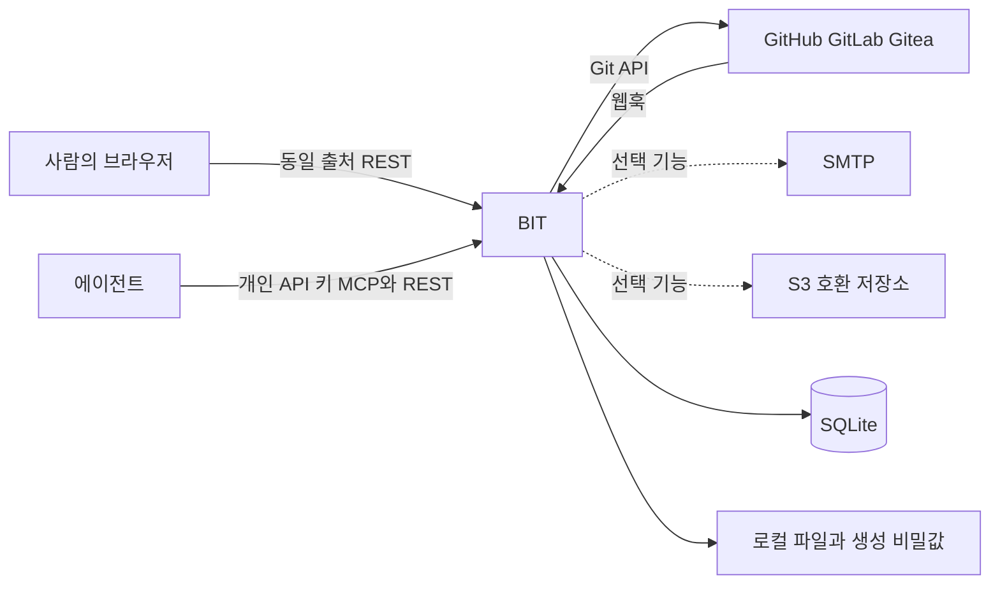

# 사용자·외부 시스템·책임 경계

BIT가 소유하는 것은 업무와 맥락의 연결입니다. Git 저장소·메일 전달·외부 객체 저장소의 운영 자체는 외부 시스템의 책임입니다.

## 업무 맥락

워크스페이스는 역할·멤버와 공통 자료의 범위입니다. 프로젝트는 같은 목표의 업무와 자료를 묶습니다. 프로젝트 진입 시 메뉴와 콘텐츠가 그 범위로 바뀌지만 공통 목록에서 연 자료의 소속을 바꾸지는 않습니다. 프로젝트 참여자 지정과 프로젝트 접근 권한은 다릅니다.

## 기술 인터페이스

| 상대 | 인터페이스 | BIT의 책임 |
| --- | --- | --- |
| 브라우저 | `/api/v1`, 쿠키·CSRF, 정적 화면 | 요청 검증·권한·DTO·오류와 화면 제공 |
| 에이전트 | `/api/mcp`, Bearer 개인 키 | 도구 스키마·작업 규칙·감사 주체 보존 |
| Git 공급자 | API·웹훅 | 연결·참조·검증과 중복 처리 정책 |
| 파일 저장소 | 로컬 또는 S3 포트 | 소유 대상 권한·첨부 관계·열기 계약 |
| 메일 공급자 | SMTP 어댑터 | 설정된 기능만 활성화 |

구체적인 인증·권한은 [접근 계약](YwbxTrzXk9.md), 실제 파일 배치는 [구성 요소](j83U7eq671.md)에서 확인합니다. SMTP 설정이 있다고 구현되지 않은 OTP·비밀번호 초기화 기능까지 존재하는 것은 아닙니다.

## 근거와 적용 기준

앱 버전은 server/build.gradle과 client/package.json 기준 0.22.0입니다. 개발 커밋은 출시 버전과 구분합니다. 근거 링크는 현재 체크아웃의 원본이며, 실제 코드 발췌는 공백을 정규화해 대조했습니다. 실행 검사 이력은 BIT-148을 따르며 이 정적 검수는 새 실행/화면 검증을 뜻하지 않습니다.

- [server/src/main/resources/application.properties](../../../server/src/main/resources/application.properties)
- [server/src/main/java/io/github/goraebap/bit/module/mcp/application/McpServerConfig.java](../../../server/src/main/java/io/github/goraebap/bit/module/mcp/application/McpServerConfig.java)
- [server/src/main/java/io/github/goraebap/bit/module/manual/application/ManualService.java](../../../server/src/main/java/io/github/goraebap/bit/module/manual/application/ManualService.java)
