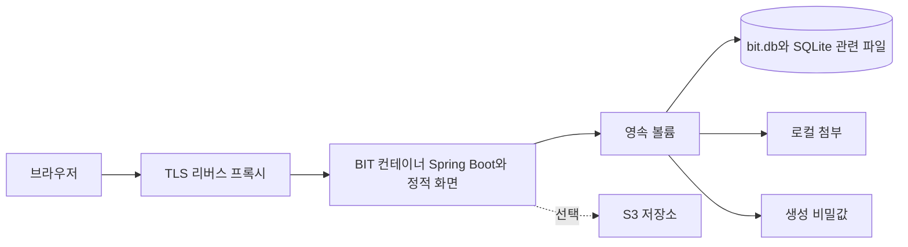

# 개발·이미지·운영 노드와 데이터

개발에서는 Vite와 Spring Boot를 나누어 띄우고 운영에서는 빌드한 화면과 서버를 이미지 하나로 실행합니다. 실제 배포 명령은 [개발 매뉴얼의 배포 절차](../development/tpKZ6UIr31.md)로 이동했습니다.

## 환경 간 차이

| 환경 | 화면 | 서버/저장 | 주의할 경계 |
| --- | --- | --- | --- |
| 일반 개발 | Vite 기본 4402 | 서버 기본 8080·개발 데이터 | proxy 대상과 Origin·dev cookie |
| 격리 검증 | 빈 포트 Vite | 빈 포트 서버·run 전용 DB/계정 | 다른 세션과 데이터·로그인 분리 |
| 이미지 실행 | 이미지 내 정적 파일 | 앱 포트·영속 볼륨 | 파일 권한·환경 설정·실제 이미지 태그 |
| 운영 | TLS 프록시 뒤 동일 출처 | 단일 앱·보존 볼륨 | HTTPS 쿠키·백업·키·외부 저장소 |

운영 노드의 앱 디렉터리·compose 서비스 이름은 저장소 예제와 다를 수 있습니다. 절차 수행 시 실제 compose와 마운트를 확인합니다. S3를 사용해도 DB와 생성 키의 백업 필요는 남습니다. 이미지 되돌리기와 데이터 되돌리기는 호환성을 따로 판단합니다.

## 근거와 적용 기준

앱 버전은 server/build.gradle과 client/package.json 기준 0.22.0입니다. 개발 커밋은 출시 버전과 구분합니다. 근거 링크는 현재 체크아웃의 원본이며, 실제 코드 발췌는 공백을 정규화해 대조했습니다. 실행 검사 이력은 BIT-148을 따르며 이 정적 검수는 새 실행/화면 검증을 뜻하지 않습니다.

- [Dockerfile](../../../Dockerfile)
- [deploy/prod/compose.yaml](../../../deploy/prod/compose.yaml)
- [client/vite.config.ts](../../../client/vite.config.ts)
- [server/src/main/resources/application.properties](../../../server/src/main/resources/application.properties)
- 현재 지침 원본: `.agents/skills/bit-development/references/architecture/deploy.md`
