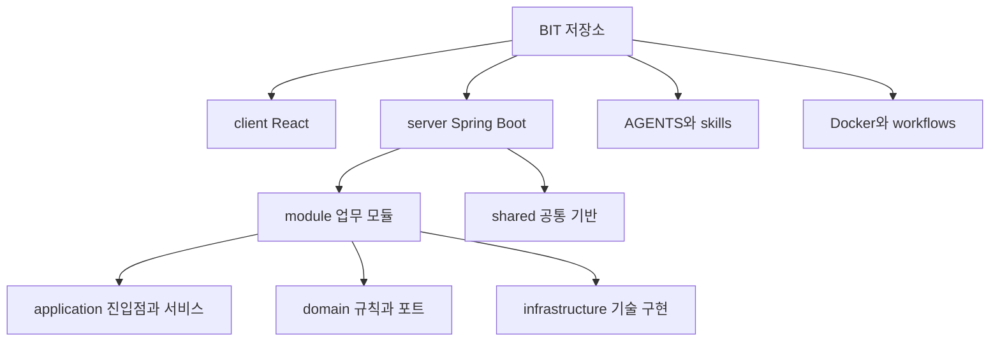

# 저장소·서버 모듈·화면 책임

최상위에서 화면·서버·작업 지침의 책임을 구분하고, 서버 안에서는 업무 모듈별로 경계를 좁힙니다.

## 서버의 주요 책임 묶음

| 모듈 | 책임 |
| --- | --- |
| iam·workspace·project | 인증 주체·공간 역할·프로젝트와 워크플로 |
| workitem·view·label·navigation | 작업/일정·보기 조건·라벨·범위 메뉴/즐겨찾기 |
| manual·document·file | 책·리소스/HTML 페이지·첨부와 저장소 |
| link·coderef·notification | 맥락 관계·외부 Git 참조·알림 |
| mcp | Streamable HTTP와 모듈 도구 집계 |
| decision·session | 기존 결정/세션 구현. 새 기록 위치는 현행 지침 확인 |

이 묶음은 배포 단위가 아닙니다. 모든 모듈이 같은 서버에서 실행합니다. 스케줄은 `workitem`의 event 종류이며 별도 schedule 모듈이 아닙니다.

## 매뉴얼 기능을 한 단계 확대해 보기

`ManualController`와 `ManualMcpTools`는 `ManualService`를 호출합니다. 서비스는 권한·책 버전·이미지 소유권·감사를 처리하고 `Manual`/`ManualContent`는 내용 불변식을 검사합니다. `ManualRepository`를 `JooqManualRepository`가 구현하며 목록은 `ManualQuery` 투영을 사용합니다. 파일은 `FileFacade`, 공간과 프로젝트는 공개 Facade로 접근합니다.

화면의 `pages/project/manuals`는 읽기·편집·목록·내보내기를 소유합니다. 경로상 project 그룹에 있어도 워크스페이스 범위에서도 재사용합니다. 위치를 제품 권한 규칙으로 해석하지 않습니다. 구현 배치의 설계 기준과 실제 예는 [계층](tIv5Msv7KG.md)과 [FSD](LlJflSsoiL.md)에 있습니다.

## 근거와 적용 기준

앱 버전은 server/build.gradle과 client/package.json 기준 0.22.0입니다. 개발 커밋은 출시 버전과 구분합니다. 근거 링크는 현재 체크아웃의 원본이며, 실제 코드 발췌는 공백을 정규화해 대조했습니다. 실행 검사 이력은 BIT-148을 따르며 이 정적 검수는 새 실행/화면 검증을 뜻하지 않습니다.

- [server/src/test/java/io/github/goraebap/bit/ArchitectureTest.java](../../../server/src/test/java/io/github/goraebap/bit/ArchitectureTest.java)
- [server/src/main/java/io/github/goraebap/bit/module/manual/application/ManualService.java](../../../server/src/main/java/io/github/goraebap/bit/module/manual/application/ManualService.java)
- [client/src/pages/project/manuals/ui/ManualWorkspace.tsx](../../../client/src/pages/project/manuals/ui/ManualWorkspace.tsx)
