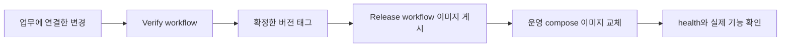

# 변경이 운영에 도달하는 경로

커밋·검증·게시·운영 교체는 서로 다른 상태입니다. main 병합이나 이미지 게시만으로 운영 적용이 끝났다고 하지 않습니다.

`verify.yml`은 서버·화면·스킬 검사를 수행합니다. `release.yml`은 v 태그를 받아 이미지를 만들고 게시하는 경로입니다. 버전 선택, 태그와 이미지 게시, 운영 교체의 승인은 해당 작업 범위에서 확인합니다. 매뉴얼 작성 요청은 게시·배포 승인이 아닙니다.

검사 구성은 [품질 요구](wSwn4EnNhp.md), 명령과 실패 시 중단 기준은 [릴리스 준비](../development/U0JhDpQURF.md), 운영 교체는 [배포·복구](../development/tpKZ6UIr31.md)에 있습니다. 릴리스 입력과 운영 이미지가 연결되는지 확인하되 이번 문서 작업에서 운영을 교체하지 않습니다.

## 근거와 적용 기준

앱 버전은 server/build.gradle과 client/package.json 기준 0.22.0입니다. 개발 커밋은 출시 버전과 구분합니다. 근거 링크는 현재 체크아웃의 원본이며, 실제 코드 발췌는 공백을 정규화해 대조했습니다. 실행 검사 이력은 BIT-148을 따르며 이 정적 검수는 새 실행/화면 검증을 뜻하지 않습니다.

- [.github/workflows/verify.yml](../../../.github/workflows/verify.yml)
- [.github/workflows/release.yml](../../../.github/workflows/release.yml)
- [.agents/skills/bit-development/playbooks/release.md](../../../.agents/skills/bit-development/playbooks/release.md)
