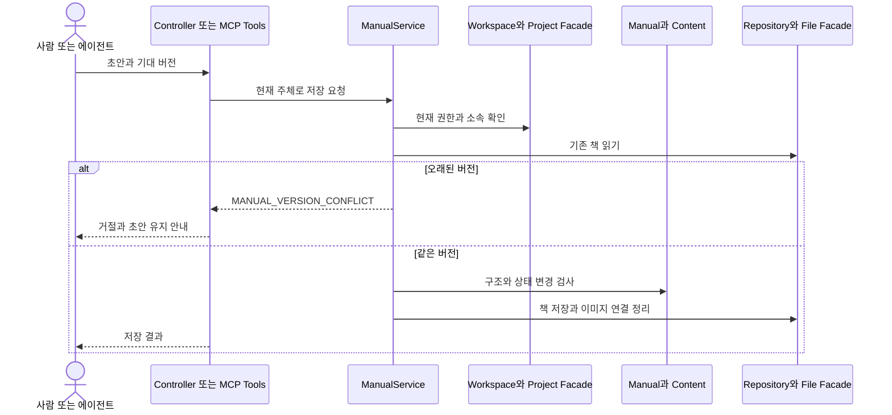

# 매뉴얼 읽기·저장·충돌 시나리오

구조가 실제 요청에서 어떻게 협력하는지 매뉴얼 저장 경로로 설명합니다. HTTP와 MCP는 전송 방식이 다르지만 최종 쓰기 규칙은 같은 서비스에 있습니다.

## 읽기

목록은 제목·설명·색·페이지 수 등의 요약을 반환합니다. 본문 전체와 첨부 URL은 상세 읽기에서 가져옵니다. 첨부를 열 때도 책 읽기 권한을 확인합니다. MCP의 페이지 조회는 필요한 한 페이지를 반환하지만 현재 도구 내부에서는 책을 읽어 선택합니다. 응답이 작다는 사실을 서버 저장 모델이 페이지별이라는 뜻으로 해석하지 않습니다.

## 실패와 회복

버전 충돌은 최신 책을 읽고 초안과 합치는 경로로 회복합니다. 예전 본문에 새 버전만 붙여 자동 재전송하면 다른 사람의 변경을 지웁니다. 권한 거절은 버튼 숨김으로 끝내지 않고 서비스에서 거절합니다. 이미지 참조 누락·잘못된 섹션·중복 ID는 저장 계약을 위반합니다.

서비스·DB 쓰기는 트랜잭션으로 묶지만 외부 파일 작업이 DB와 분산 트랜잭션으로 원자적이라고 보장하지 않습니다. 그 한계는 [운영 위험](EQUszOg1KB.md)에 있습니다. 설계 기준과 실제 예는 [버전·감사](qoPHQyNfIG.md), [기능 검증](../development/RqGTB7dtd6.md)에서 확인합니다.

## 근거와 적용 기준

앱 버전은 server/build.gradle과 client/package.json 기준 0.22.0입니다. 개발 커밋은 출시 버전과 구분합니다. 근거 링크는 현재 체크아웃의 원본이며, 실제 코드 발췌는 공백을 정규화해 대조했습니다. 실행 검사 이력은 BIT-148을 따르며 이 정적 검수는 새 실행/화면 검증을 뜻하지 않습니다.

- [server/src/main/java/io/github/goraebap/bit/module/manual/application/ManualService.java](../../../server/src/main/java/io/github/goraebap/bit/module/manual/application/ManualService.java)
- [server/src/main/java/io/github/goraebap/bit/module/manual/application/ManualMcpTools.java](../../../server/src/main/java/io/github/goraebap/bit/module/manual/application/ManualMcpTools.java)
- [client/src/pages/project/manuals/ui/ManualWorkspace.tsx](../../../client/src/pages/project/manuals/ui/ManualWorkspace.tsx)
