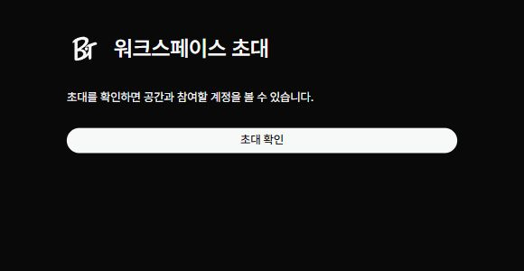
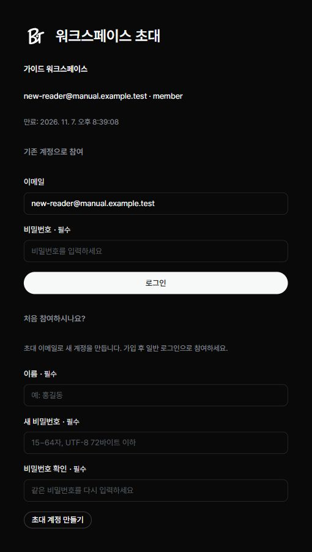

관리자에게 받은 초대 링크로 워크스페이스에 참여합니다. 링크를 열기 전에 초대받은 이메일을 확인하세요.

## 초대 확인하기

1. 관리자에게 받은 원래 링크를 브라우저에서 여세요.
2. ‘초대 확인’을 누르세요.
3. 워크스페이스 이름과 초대 이메일을 확인하세요.

## 처음 가입하는 경우

‘처음 참여하시나요?’ 아래에서 계정을 만듭니다.

1. ‘이름’을 입력하세요.
2. ‘새 비밀번호’와 ‘비밀번호 확인’을 입력하세요. 화면에 표시된 길이 조건을 따르세요.
3. ‘초대 계정 만들기’를 누르세요.
4. 로그인 화면으로 이동하면 초대받은 이메일과 방금 정한 비밀번호로 로그인하세요.

## 이미 계정이 있는 경우

1. ‘기존 계정으로 참여’에서 초대받은 이메일의 계정으로 로그인하세요.
2. 초대 화면에서 로그인 이메일이 맞는지 확인하세요.
3. ‘초대 수락’을 누르세요.

다른 계정으로 로그인되어 있다면 ‘다른 계정으로 로그인’을 사용하세요. 로그인 화면으로 이동했다면 계정을 전환한 뒤 원래 초대 링크를 다시 여세요.

## 참여되지 않을 때

- 링크가 만료되었거나 이미 사용되었다면 관리자에게 새 초대를 요청하세요.
- 초대는 다른 이메일의 계정으로 수락할 수 없습니다.
- 비밀번호 변경을 먼저 하라는 안내가 나오면 변경을 마친 뒤 원래 초대 링크를 다시 여세요.
- 주소에서 초대 정보가 사라진 상태로 새로고침했다면 관리자에게 받은 원래 링크로 돌아가세요.
