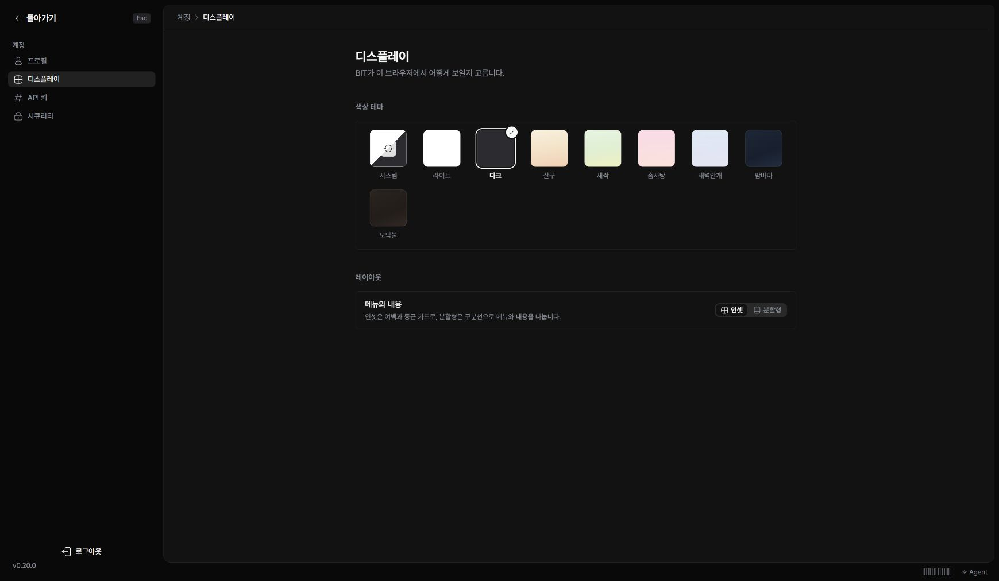

왼쪽 아래 프로필의 ‘내 설정’에서 계정 이름과 이 브라우저의 표시 방식을 바꿉니다.

## 이름과 사진 변경하기

‘프로필’에서 이름을 고치고 ‘저장’을 누르세요. 사진을 누르면 새 사진을 선택할 수 있습니다. 이메일은 로그인에 사용되며 변경이 필요하면 인스턴스 관리자에게 요청하세요.

## 테마와 레이아웃 선택하기

1. ‘디스플레이’를 여세요.
2. 색상 테마를 선택하세요.
3. 필요하면 ‘레이아웃’에서 인셋 또는 분할형을 선택하세요.

선택은 바로 적용됩니다. ‘시스템’은 기기의 라이트·다크 설정을 따릅니다. 다른 브라우저에서는 그 브라우저의 표시 설정을 따로 확인하세요. 매뉴얼의 글과 화면은 테마를 따르지만, 삽입된 사진이나 그림 자체의 색은 바뀌지 않습니다.
