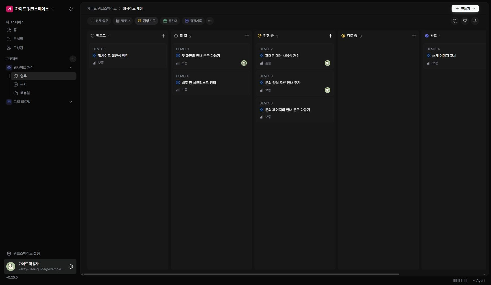
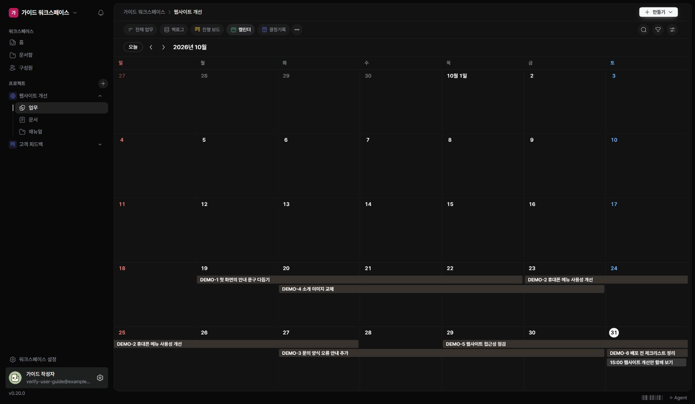

같은 업무를 상태 또는 날짜를 기준으로 살펴볼 수 있습니다.

## 보드에서 진행 상황 보기

1. 프로젝트 업무에서 ‘진행 보드’를 여세요.
2. 상태별 카드에서 업무를 찾으세요.
3. 제목을 눌러 상세 내용을 확인하세요.

## 캘린더에서 날짜 보기

1. ‘캘린더’를 여세요.
2. 이전·다음 버튼으로 달을 이동하세요.
3. ‘오늘’을 누르면 현재 날짜가 있는 달로 돌아갑니다.
4. 표시된 업무를 눌러 상세를 확인하세요.

## 보이지 않는 항목 찾기

작업에 시작일·기한이 있는지, 일정의 날짜가 현재 보고 있는 달에 포함되는지 확인하세요. 보드의 오른쪽 칸은 가로로 이동해 확인할 수 있습니다.
