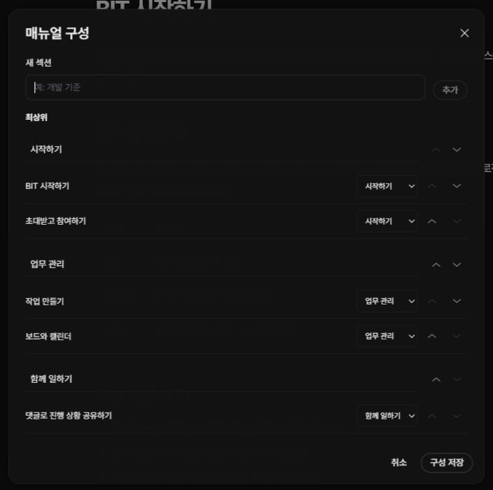

사용자 안내나 개발 지침처럼 체계적인 설명이 필요할 때 매뉴얼을 만드세요. 하나의 프로젝트에 여러 매뉴얼을 둘 수 있습니다.

## 매뉴얼 만들기

1. 프로젝트의 ‘매뉴얼’을 여세요.
2. 오른쪽 위 ‘매뉴얼 만들기’를 누르세요.
3. 이름과 설명을 입력하세요.
4. 기본 표지를 고르거나 표지 이미지를 선택하세요.
5. 저장 후 새 매뉴얼을 여세요.

## 섹션과 페이지 정리하기

‘페이지 추가’에서 제목과 섹션을 정합니다. ‘구성 편집’에서는 섹션을 만들고 이름을 바꾸거나, 페이지를 다른 섹션으로 옮길 수 있습니다. 위·아래 버튼으로 읽는 순서를 정하고 ‘구성 저장’을 누르세요.

## 저장 범위 확인하기

현재 제공된 로컬 매뉴얼 화면은 브라우저마다 따로 저장합니다. 다른 브라우저에서 같은 내용을 보려면 매뉴얼 파일을 가져와야 합니다. 브라우저 데이터를 지우기 전에 ‘매뉴얼 원본 내보내기’로 최신 내용을 보관하세요. 댓글은 원본 파일에 포함되지 않습니다.
