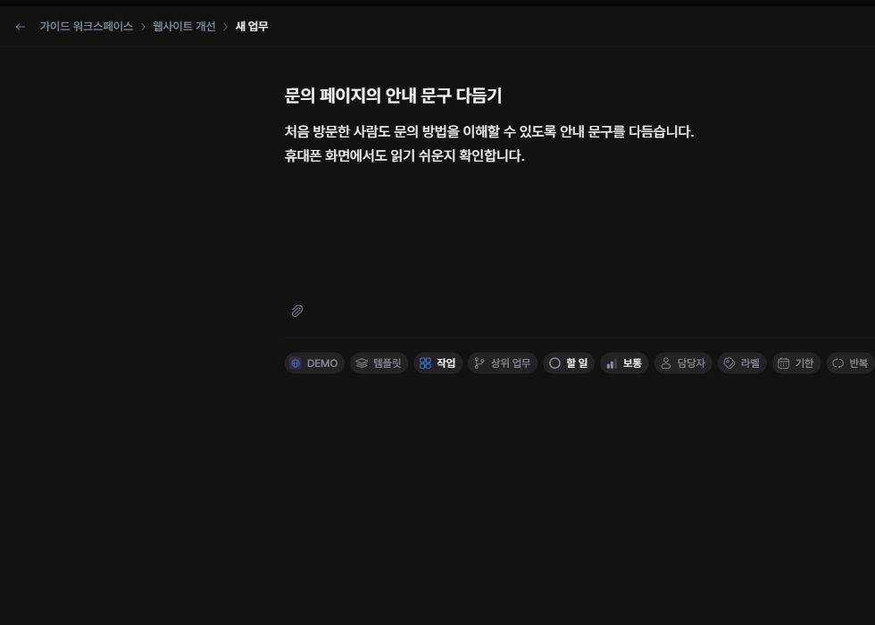

작업에는 해야 할 일과 완료 기준을 적습니다. 제목은 결과를 이해할 수 있게 쓰고, 설명에는 배경과 확인할 내용을 적으세요.

## 새 작업 등록하기

1. 프로젝트의 ‘업무’를 여세요.
2. 상단 ‘만들기’에서 ‘작업’을 선택하세요.
3. 제목과 설명을 입력하세요.
4. 상태·담당자·날짜 등 필요한 속성을 확인하세요.
5. ‘작업 만들기’를 누르세요.

## 완료 기준 작성하기

설명에 체크 목록을 넣으면 확인할 결과가 명확해집니다.

- [ ] 문의 양식의 필수 항목 안내를 확인한다.
- [ ] 휴대폰에서도 안내 문구가 잘 보이는지 확인한다.

## 등록 결과 확인하기

업무 목록에 제목과 번호가 나타납니다. 번호는 저장할 때 정해지므로 미리 예상해 다른 문서에 적지 마세요. 유형에 따라 상위 업무가 필요하다는 안내가 나오면 적절한 상위를 선택하세요.
