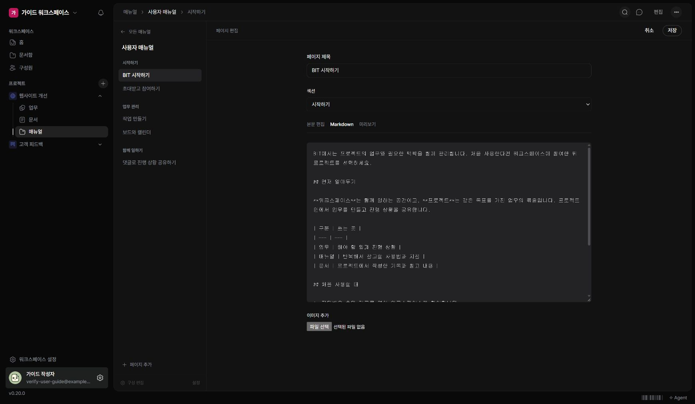

매뉴얼의 각 페이지는 제목과 Markdown 본문으로 작성합니다.

## 페이지 편집하기

1. 수정할 페이지를 여세요.
2. 상단 ‘편집’을 누르세요.
3. 제목과 섹션을 확인하고 본문을 고치세요.
4. ‘미리보기’에서 읽는 모습을 확인하세요.
5. ‘저장’을 누르세요.

## 표·코드·이미지 넣기

본문 편집에서 ‘/’로 블록을 선택하거나 ‘Markdown’에서 원문을 작성할 수 있습니다. ‘이미지 추가’로 사진을 넣으면 본문 끝에 추가됩니다. 읽기 화면의 사진은 눌러 확대할 수 있습니다.

현재 화면에서 이미지 한 장은 2MB까지 선택할 수 있습니다. 여러 이미지를 넣을 때는 브라우저 전체 저장 공간도 고려하세요. 큰 화면 전체보다 단계에 필요한 영역을 잘라 넣으면 읽기 쉽습니다.

## 편집을 그만둘 때

‘취소’를 누르면 변경을 버릴지 확인합니다. 다른 페이지로 이동하려다 취소해도 입력은 유지됩니다. 편집 중 새 페이지를 추가하려면 먼저 저장하거나 취소하세요.
