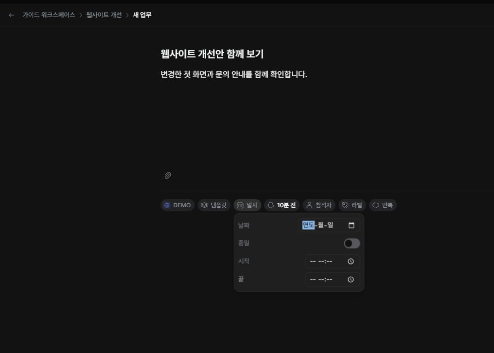

회의처럼 참석자와 시각이 필요한 일은 ‘일정’으로 만듭니다. 작업의 기한과 일정의 시작·종료 시각은 서로 다릅니다.

## 일정 등록하기

1. 업무 화면의 ‘만들기’에서 ‘일정’을 선택하세요.
2. 제목과 설명을 입력하세요.
3. 참석자와 시작·종료 시각을 정하세요. 하루 단위 일정이면 종일 설정을 사용하세요.
4. 필요한 반복과 알림을 선택하고 저장하세요. 종일 일정에는 알림 선택이 표시되지 않습니다.

## 반복을 사용할 때

매일·매주·매월 등 반복 주기와 필요한 간격을 선택합니다. 반복 항목을 수정할 때는 현재 항목만 바꾸는지, 이후 반복에도 반영하는지 화면의 범위를 확인하세요. 제목과 설명을 바꿀 때 ‘이후 모두’는 다음에 생성되는 회차부터 적용되며, 이미 생성된 다른 회차의 내용은 바뀌지 않습니다.

## 시간과 알림 확인하기

저장 후 캘린더에서 날짜와 시간을 다시 확인하세요. 일정에는 작업의 상태 칸이 없습니다. 알림 방식은 인스턴스에서 켜 둔 기능의 영향을 받을 수 있습니다.
