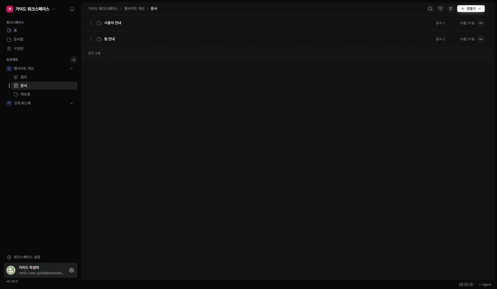

문서함은 워크스페이스의 프로젝트 문서와 공통 문서를 모아 봅니다. 프로젝트의 ‘문서’는 그 프로젝트 범위를 바로 엽니다.

## 문서 찾기

1. 왼쪽 ‘문서함’ 또는 프로젝트의 ‘문서’를 여세요.
2. 프로젝트와 폴더를 열어 범위를 좁히세요.
3. 제목을 눌러 문서를 읽으세요.

## 폴더 정리하기

현재 위치에서 ‘만들기’ 메뉴의 ‘새 폴더’를 사용합니다. 이름과 색상을 정하세요. 폴더 메뉴의 ‘이름·색상 바꾸기’로 표시를 수정할 수 있습니다. 문서를 만들 때는 저장 위치를 함께 확인하세요.

## 찾는 문서가 없을 때

공통 문서인지 프로젝트 문서인지부터 확인하세요. 현재 폴더와 검색 조건이 달라서 보이지 않을 수 있습니다. 문서 제목을 바꾸더라도 기존 문서의 식별자는 유지됩니다.
