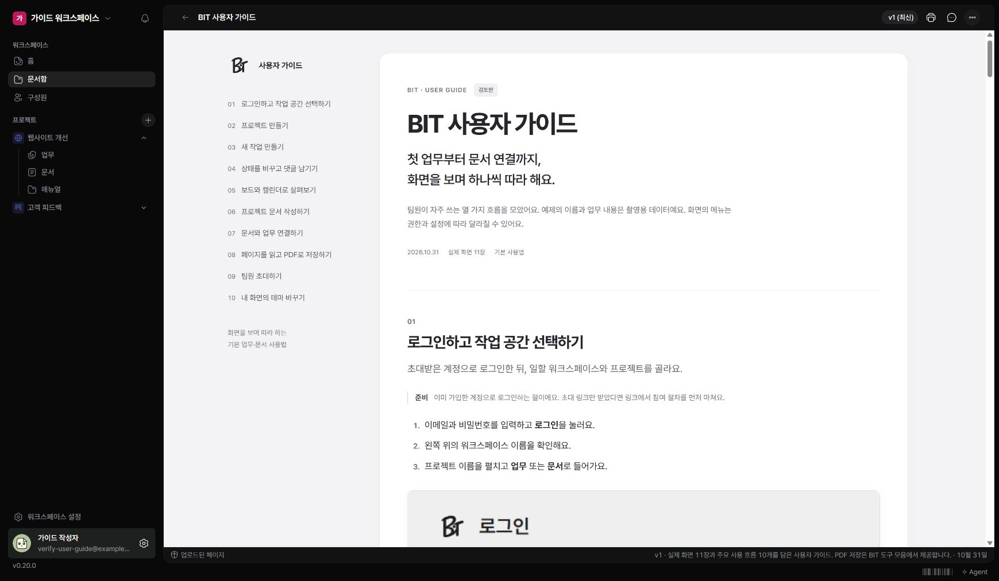

문서함에는 Markdown 문서와 함께 HTML 결과물을 보는 ‘페이지’가 있을 수 있습니다. 페이지는 업로드한 결과물의 모양을 유지해 보여줍니다.

## 페이지 열기

1. 문서함에서 페이지 제목을 누르세요.
2. 상단 버전 선택에서 읽을 버전을 고르세요.
3. 내용은 가운데에서, 댓글과 정보는 상단 도구에서 확인하세요.

## 새 버전과 기존 버전

새 결과물을 올리면 기존 버전을 덮어쓰지 않고 버전이 추가됩니다. 현재 표시 중인 버전을 확인한 뒤 의견을 남기세요. HTML 본문을 일반 문서처럼 직접 편집하는 화면은 제공하지 않습니다.

## PDF로 저장하기

상단 ‘PDF로 저장’을 누르고 브라우저 인쇄 창에서 PDF 저장 대상을 선택합니다. 용지·여백·배율과 그림 잘림을 미리보기에서 확인하세요. 브라우저에 따라 인쇄 창의 이름은 다를 수 있습니다.

내용이 비거나 인쇄 창이 열리지 않으면 페이지를 다시 열고 브라우저의 팝업·인쇄 설정을 확인하세요.
