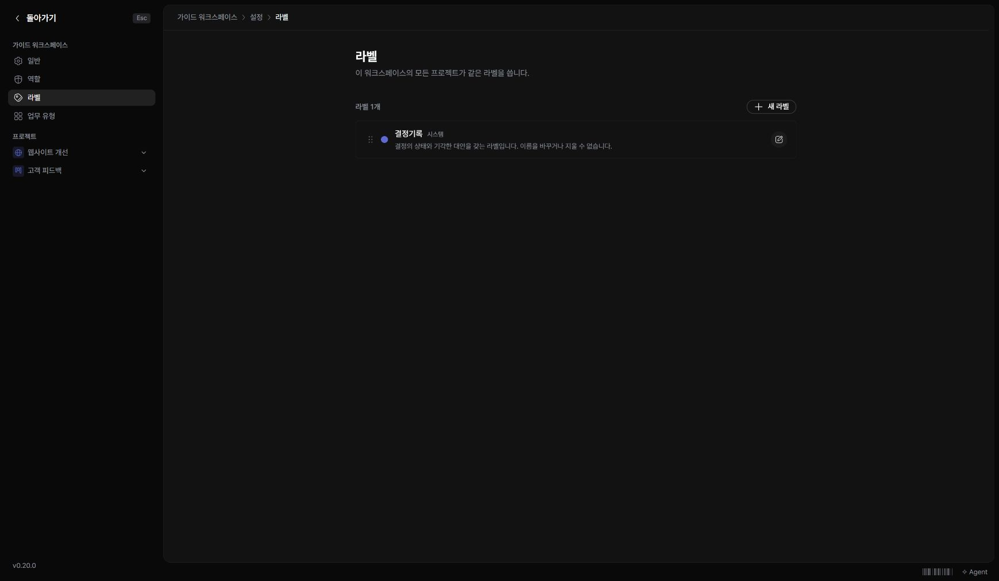
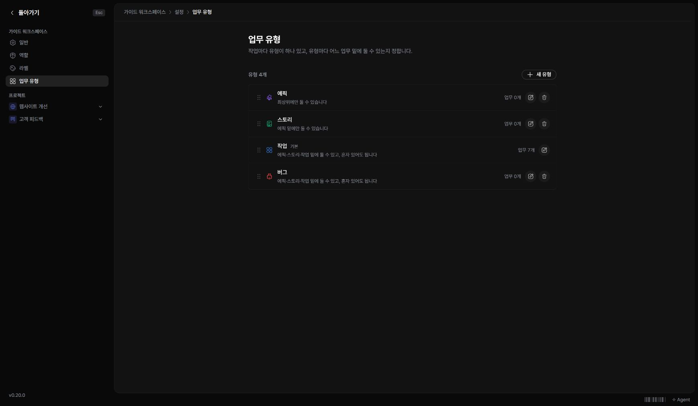

라벨은 분류에, 업무 유형은 일의 성격과 상위 규칙에 사용합니다. 워크스페이스 관리 권한이 필요합니다.

## 라벨 만들기

1. ‘워크스페이스 설정 → 라벨’을 여세요.
2. ‘새 라벨’을 눌러 이름과 색을 정하세요.
3. 업무나 문서 상세에서 필요한 라벨을 선택하세요.

## 업무 유형 정하기

1. ‘워크스페이스 설정 → 업무 유형’을 여세요.
2. 유형의 이름·표시와 상위 규칙을 확인하세요.
3. 새 유형을 만들거나 기존 유형을 고친 뒤 저장하세요.

유형 규칙을 바꾸면 새 업무를 만들거나 상위를 변경할 때 영향을 줍니다. 기존 업무가 있는 유형을 변경·삭제할 때는 화면의 제한과 안내를 확인하세요.
