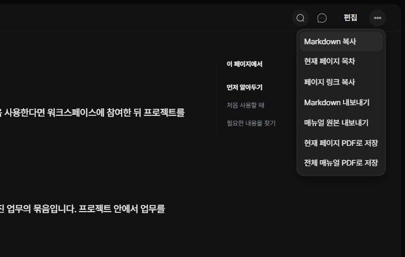

상단 페이지 도구에서 읽고 있는 내용을 복사하거나 파일로 보관할 수 있습니다.

## 내용과 링크 복사하기

‘Markdown 복사’는 현재 페이지의 제목과 원문을 복사합니다. ‘페이지 링크 복사’는 해당 페이지를 여는 주소를 복사합니다. 링크를 받는 브라우저에도 매뉴얼이 있어야 내용을 볼 수 있습니다.

## Markdown 내보내기

‘Markdown 내보내기’를 선택하세요. 그림이 없는 페이지는 .md 파일로, 그림이 있으면 원본 그림과 상대 경로를 포함한 ZIP으로 내려받습니다. ZIP을 사용할 때는 Markdown 파일과 images 폴더의 위치 관계를 유지하세요.

## PDF로 저장하기

‘현재 페이지 PDF로 저장’과 ‘전체 매뉴얼 PDF로 저장’ 중 필요한 범위를 선택합니다. 브라우저 인쇄 창에서 PDF 저장 대상을 고르고, 페이지 나눔과 그림을 확인하세요. 팝업이 차단되면 허용한 뒤 다시 시도하세요.

## 개선 의견 남기기

상단 댓글 아이콘을 눌러 현재 페이지의 잘못된 설명이나 개선 의견을 적고 ‘댓글 남기기’를 누르세요. 반영한 의견은 ‘해결 처리’하고, ‘해결됨’에서 다시 열 수 있습니다. 특정 문장에 고정하는 댓글이 아니라 페이지 단위 의견입니다.

## 매뉴얼 파일 가져오기

목록 상단 ‘매뉴얼 도구 → 매뉴얼 가져오기’에서 BIT 매뉴얼 JSON 파일을 선택하세요. 4MB 이하의 파일을 선택한 뒤 이름과 구성을 확인하고 ‘가져오기’를 누르면 새 매뉴얼로 추가됩니다. 기존 매뉴얼은 덮어쓰지 않으며 파일에 포함된 댓글은 가져오지 않습니다.

다른 브라우저로 옮기거나 수정한 내용을 보관하려면 페이지 도구의 ‘매뉴얼 원본 내보내기’를 사용하세요. 전체 구성·본문·이미지가 BIT 매뉴얼 JSON으로 저장되며 댓글은 제외됩니다. 페이지 단위 Markdown/ZIP은 전체 매뉴얼 가져오기 파일이 아닙니다.
