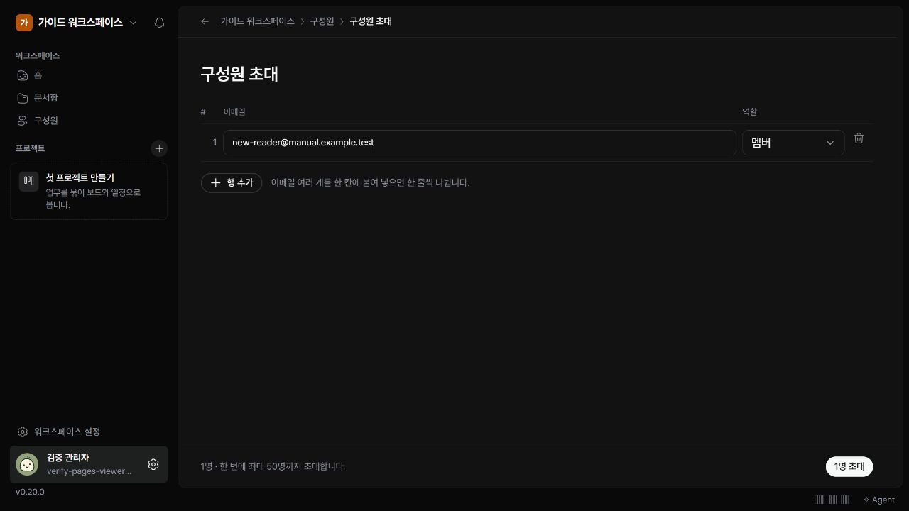

초대 권한이 있는 사용자는 구성원에게 참여 링크를 만들 수 있습니다.

## 초대 보내기

1. 왼쪽 ‘구성원’을 여세요.
2. ‘구성원 초대’를 누르세요.
3. 이메일과 역할을 입력하세요. 여러 명이면 행을 추가하세요.
4. 인원이 표시된 초대 버튼을 누르세요.
5. 결과 화면에서 각 사람의 링크를 복사해 해당 사람에게 전달하세요.

## 링크를 보관할 때

초대 링크는 생성 직후 한 번만 표시되고 7일 동안 한 번 사용할 수 있습니다. 여러 링크를 복사했다면 사람과 이메일이 뒤바뀌지 않도록 확인하세요.

## 참여 상태 확인하기

‘구성원’에서 참여한 사람을, ‘초대’ 탭에서 대기 중인 초대를 확인합니다. 링크를 놓쳤다면 대기 중인 초대를 폐기한 뒤 새 초대를 만드세요. 기존 구성원에게 중복 초대를 보내지 않도록 먼저 목록을 확인하세요.
