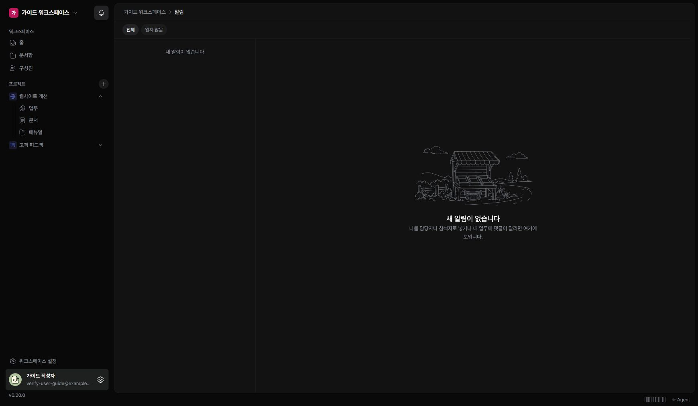

업무 변경이나 댓글 등 나와 관련된 알림은 알림함에서 확인합니다.

## 알림 열기

1. 메뉴 위쪽의 종 모양 ‘알림’을 누르세요.
2. ‘전체’ 또는 ‘읽지 않음’을 선택하세요.
3. 알림 항목을 선택해 내용을 읽으세요.
4. 원본 업무 링크로 이동해 필요한 작업을 하세요.

## 읽음 처리하기

알림을 읽거나, 읽지 않은 알림이 있을 때 ‘모두 읽음’을 사용할 수 있습니다. 읽음 처리는 업무를 완료시키는 동작이 아닙니다.

## 메일이 오지 않을 때

알림함에 먼저 내용이 있는지 확인하세요. 메일 전송은 인스턴스의 메일 설정이 필요합니다. 계정이나 프로젝트 접근 권한이 바뀌면 원본을 열 수 없는 경우도 있습니다.
