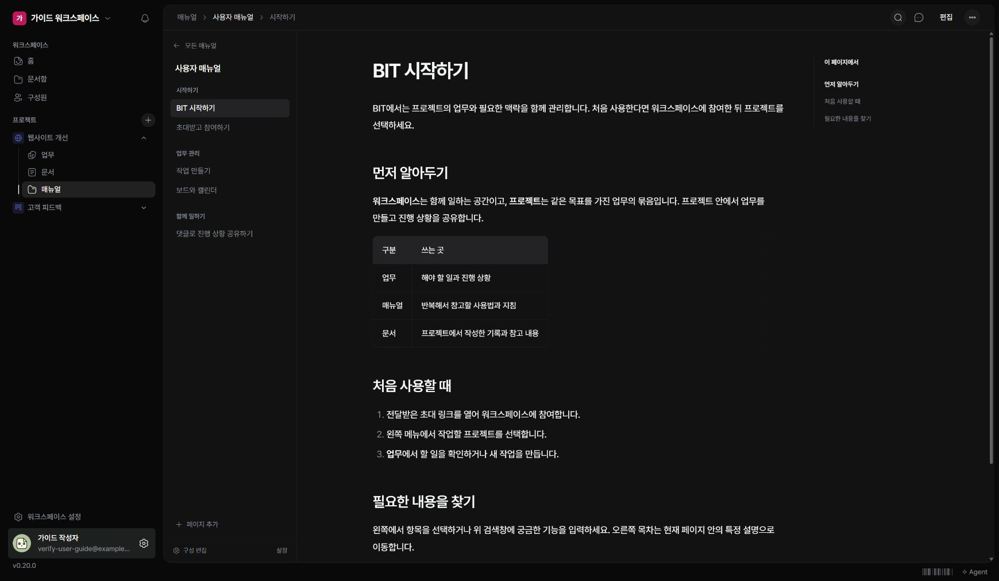

매뉴얼은 사용 방법과 지침을 섹션과 페이지로 구성합니다. 프로젝트의 ‘매뉴얼’에서 읽을 항목을 선택하세요.

## 읽을 내용 찾기

왼쪽 메뉴는 매뉴얼 전체의 구성이고, 오른쪽 ‘이 페이지에서’는 현재 페이지 안의 제목입니다. 아래의 이전·다음 페이지로 순서대로 읽을 수도 있습니다.

## 내용 검색하기

1. 상단 검색 아이콘을 누르세요.
2. 찾을 단어를 입력하세요.
3. 왼쪽 검색 결과에서 페이지를 선택하세요.
4. 검색을 끝내려면 닫기 버튼을 누르세요.

## 탐색 공간 조절하기

넓은 화면에서는 메뉴와 본문 사이 경계선을 끌어 너비를 조절할 수 있습니다. 경계선에 초점을 두고 좌우 방향키로 조절할 수도 있습니다. 두 번 누르면 기본 너비로 돌아옵니다. 휴대폰에서는 ‘탐색’과 ‘목차’를 눌러 필요한 메뉴를 엽니다.
