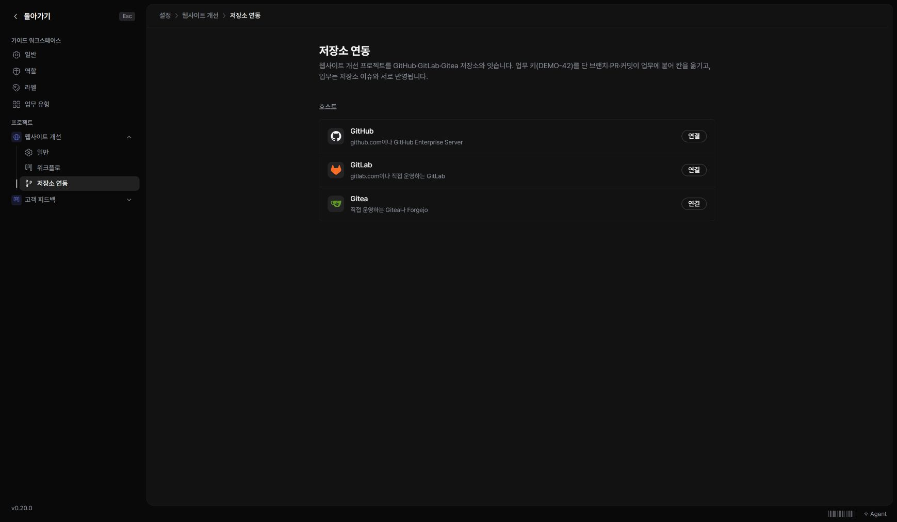

저장소 연동은 업무와 브랜치·PR·커밋을 연결하는 선택 기능입니다. 프로젝트 관리 권한과 해당 저장소의 접근 정보가 필요합니다.

## 연동 화면 열기

‘워크스페이스 설정 → 프로젝트 → 저장소 연동’을 여세요. 서버에서 기능이 꺼져 있으면 그 이유가 표시됩니다. 기능을 켜는 작업은 인스턴스 관리자에게 요청하세요.

## 연결할 때 확인할 것

연결이 가능한 환경에서는 GitHub·GitLab·Gitea 중 호스트를 선택하고 저장소와 토큰을 입력합니다. 토큰은 댓글이나 매뉴얼 본문에 남기지 마세요. 연결 후에는 이슈 동기화와 상태 이동 규칙을 확인합니다.

업무 키가 들어간 브랜치·PR·커밋이 연결의 기준입니다. 어떤 이벤트가 어느 상태로 이동시키는지는 해당 프로젝트의 연동 규칙을 따릅니다. 연동이 없어도 일반 업무와 문서는 사용할 수 있습니다.
