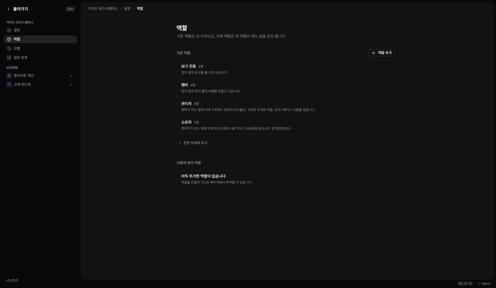

역할은 사용자가 할 수 있는 동작을 정합니다. 프로젝트 참여 범위도 함께 확인해야 합니다.

## 구성원의 권한 확인하기

1. ‘구성원’을 여세요.
2. 해당 사람의 역할과 참여 프로젝트를 확인하세요.
3. 관리 권한이 있다면 역할 또는 참여 프로젝트를 변경하세요.

## 역할 설정하기

‘워크스페이스 설정 → 역할’에서 기본 역할과 커스텀 역할을 확인합니다. 새 역할을 만들 때는 실제로 필요한 권한만 선택하세요.

소유자·관리자·멤버·보기 전용과 커스텀 역할은 같은 권한을 갖지 않습니다. 변경 버튼이 없으면 현재 역할에서 허용하지 않는 동작일 수 있습니다. 소유권 이전이나 구성원 제외는 접근에 영향을 주므로 화면의 확인 내용을 읽고 진행하세요.
