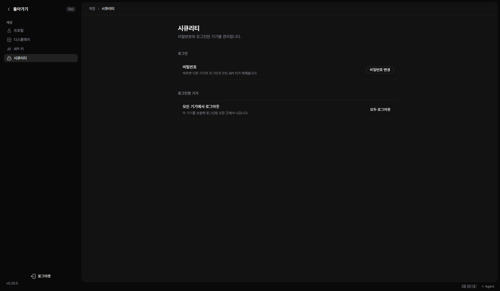

‘내 설정 → 시큐리티’에서 비밀번호와 로그인된 기기를 관리합니다.

## 비밀번호 변경하기

1. ‘비밀번호 변경’을 누르세요.
2. 현재 비밀번호와 새 비밀번호를 입력하세요.
3. 확인 입력과 길이 조건을 확인한 뒤 변경하세요.

비밀번호를 바꾸면 다른 기기의 로그인과 모든 API 키가 해제됩니다. 에이전트나 스크립트에 사용하던 키도 다시 준비해야 합니다.

## 모든 기기에서 로그아웃하기

‘모두 로그아웃’을 누르고 확인하면 현재 기기를 포함해 로그인된 모든 곳에서 나갑니다. 사용하던 계정의 이메일과 비밀번호를 알고 있는지 먼저 확인하세요.

비밀번호를 잊었거나 계정에 접근할 수 없다면 인스턴스 관리자에게 문의하세요.
