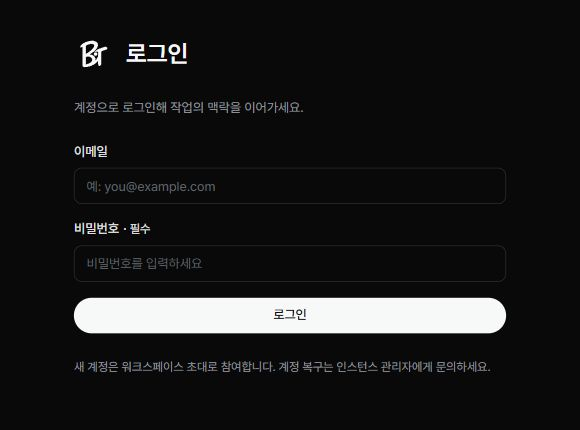

가입한 이메일과 비밀번호로 로그인합니다. 새 계정은 워크스페이스 초대를 통해 만듭니다.

## 로그인하기

1. BIT 로그인 화면을 여세요.
2. ‘이메일’과 ‘비밀번호’를 입력하세요.
3. ‘로그인’을 누르세요.

로그인 후에는 마지막으로 사용한 공간이나 공간 선택 화면으로 이동합니다. 여러 워크스페이스에 참여했다면 현재 공간을 확인하세요.

## 워크스페이스 바꾸기

1. 왼쪽 위 워크스페이스 이름을 누르세요.
2. 이동할 공간을 선택하세요.
3. 프로젝트 이름을 펼치고 필요한 메뉴를 여세요.

## 로그인이 되지 않을 때

초대받은 이메일과 로그인 이메일이 같은지 확인하세요. 계정 복구가 필요하면 인스턴스 관리자에게 문의하세요. 비밀번호를 바꾸라는 화면이 나오면 변경을 완료해야 일반 화면을 사용할 수 있습니다.
