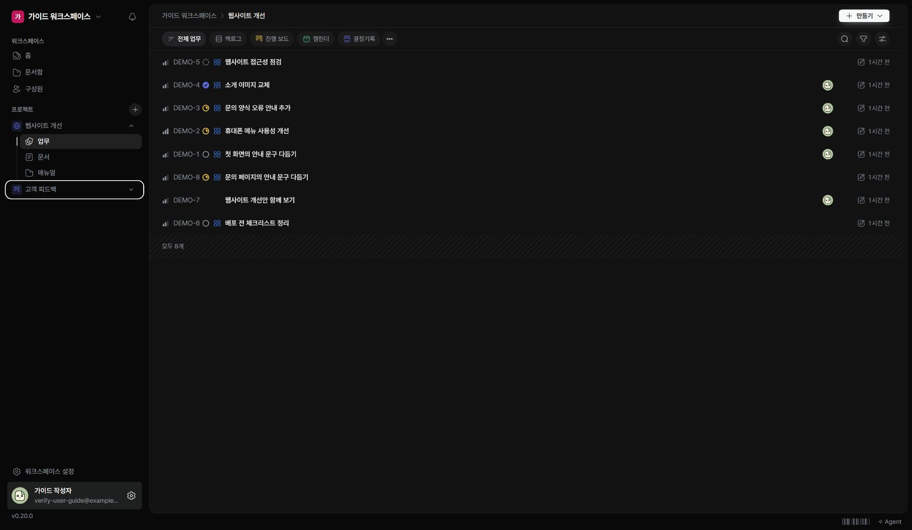

BIT에서 할 일을 관리하려면 먼저 워크스페이스에 참여하고 작업할 프로젝트를 선택하세요. 이 설명서는 ‘웹사이트 개선’ 프로젝트의 예제로 사용 방법을 안내합니다.

## 화면의 기본 구조

왼쪽 메뉴에서 작업 공간과 프로젝트를 선택합니다. 오른쪽에는 선택한 업무 목록이나 문서가 표시됩니다. 휴대폰에서는 아래 메뉴와 ‘더보기’로 이동합니다.

| 메뉴 | 사용하는 목적 |
| --- | --- |
| 홈 | 워크스페이스의 업무를 모아 확인 |
| 프로젝트의 업무 | 해당 프로젝트의 작업과 일정 관리 |
| 문서함·프로젝트의 문서 | 기록과 참고 문서 작성·열람 |
| 매뉴얼 | 사용 방법과 지침을 목차에 따라 읽고 작성 |
| 구성원 | 함께 일하는 사람과 초대 확인 |

## 처음 사용할 때

1. 초대 링크를 받았다면 ‘초대받고 참여하기’를 먼저 읽으세요.
2. 이미 가입했다면 이메일과 비밀번호로 로그인하세요.
3. 왼쪽에서 프로젝트를 펼치고 ‘업무’를 여세요.
4. ‘작업 만들기’를 따라 첫 작업을 등록하세요.

## 필요한 기능 찾기

이 매뉴얼 왼쪽 메뉴에서 주제를 선택하거나 상단 검색 아이콘으로 내용을 찾으세요. ‘이 페이지에서’ 목차는 지금 읽는 페이지의 특정 설명으로 이동합니다.

버튼이 보이지 않거나 수정할 수 없다면 먼저 본인의 역할과 프로젝트 접근 권한을 관리자에게 확인하세요.
