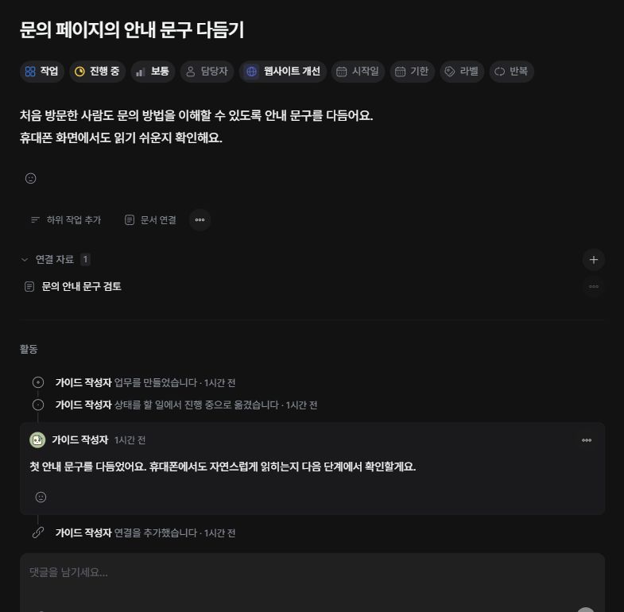

업무 제목을 눌러 상세를 열면 제목 아래에서 속성을 바꿀 수 있습니다. 목록에서 옆 패널로 열렸다면 ‘크게 보기’로 넓힐 수 있습니다.

## 속성 변경하기

1. 업무 상세에서 바꿀 속성을 누르세요.
2. 상태·우선순위·담당자·라벨은 목록에서 값을 선택하세요.
3. 시작일과 기한은 날짜 선택기에서 지정하세요.

속성은 선택 후 반영됩니다. 제목과 설명을 편집할 때 사용하는 저장 동작과 구분하세요. 변경 기록은 아래 ‘활동’에서 확인합니다.

## 담당자와 날짜 정하기

작업의 담당자는 여러 명 선택할 수 있습니다. 일정에서는 같은 위치가 ‘참석자’로 표시됩니다. 날짜를 제거하려면 날짜 선택기의 지우기 동작을 사용하세요.

## 변경되지 않을 때

수정 권한이 있는지 확인하세요. 다른 사람이 먼저 변경했다는 안내가 나오면 최신 상태를 확인한 뒤 다시 변경하세요. 업무 종류나 프로젝트 설정에 따라 표시되는 속성은 다를 수 있습니다.
