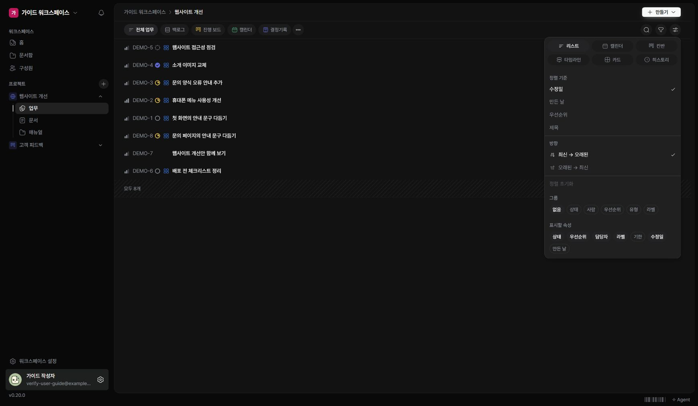

업무가 많아지면 검색과 필터로 범위를 좁히고, 자주 쓰는 구성을 뷰로 정리하세요.

## 필요한 업무 찾기

1. 업무 화면의 검색 아이콘을 누르세요.
2. 제목에 포함된 단어를 입력하세요.
3. 필요한 경우 필터에서 상태·담당자·유형·라벨 등을 선택하세요.
4. 조건을 지우면 더 넓은 범위를 다시 볼 수 있습니다.

## 표시 방식 바꾸기

‘표시’에서 레이아웃·정렬·묶기·표시할 속성을 조정합니다. 사용할 수 있는 레이아웃은 리스트, 캘린더, 칸반, 타임라인, 카드, 히스토리입니다.

## 자주 쓰는 구성 저장하기

뷰를 추가할 때 이름과 조건을 정하세요. ‘나만 보기’는 개인 뷰로 관리할 때 사용합니다. 다른 사람이 사용하는 공통 뷰와 개인 화면 조정을 구분하세요.

## 업무가 사라져 보일 때

현재 프로젝트와 검색어·필터를 먼저 확인하세요. 필터에 맞지 않는 업무는 삭제된 것이 아니라 목록에서 제외된 것일 수 있습니다.
