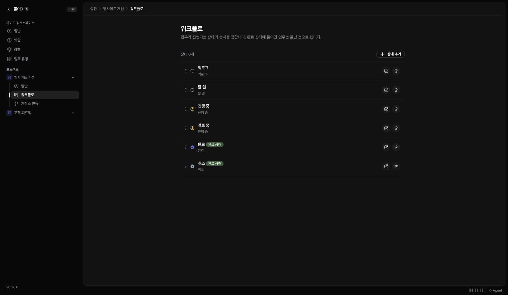

프로젝트 이름·설명과 업무 상태 칸은 프로젝트 설정에서 관리합니다.

## 프로젝트 설정 열기

1. ‘워크스페이스 설정’을 여세요.
2. 설정 메뉴에서 프로젝트를 펼치세요.
3. ‘일반’ 또는 ‘워크플로’를 선택하세요.

## 상태 칸 관리하기

‘워크플로’에서 상태를 추가하고 이름과 순서를 정합니다. 상태는 백로그·할 일·진행 중·완료·취소 중 하나의 범주에 속합니다. 상태 이름은 팀에 맞게 바꿀 수 있으며, 같은 범주 안에 여러 상태를 둘 수도 있습니다.

## 보관과 삭제를 구분하기

프로젝트를 당장 사용하지 않는다고 바로 삭제할 필요는 없습니다. 일반 설정과 프로젝트 목록에서 제공하는 보관·복원 동작을 확인하세요. 삭제나 다른 프로젝트로 이동하는 동작은 화면에 표시되는 범위와 확인 내용을 읽고 진행하세요.
