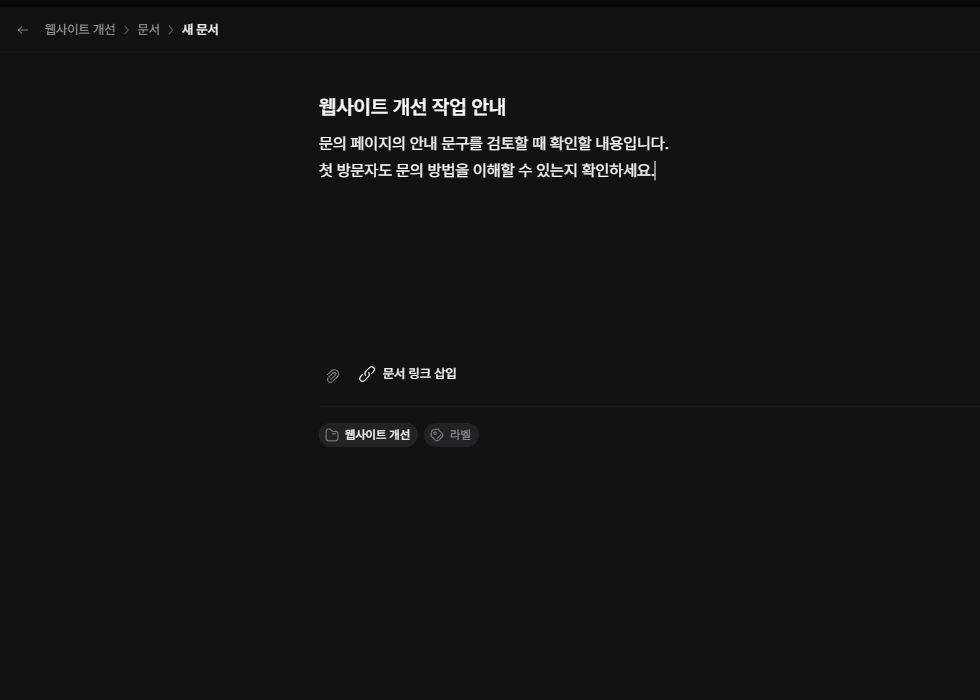

프로젝트 안내나 검토 내용을 Markdown 문서로 작성할 수 있습니다.

## 문서 등록하기

1. 저장할 프로젝트와 폴더를 여세요.
2. ‘만들기 → 새 문서’를 선택하세요.
3. 문서 제목과 본문을 입력하세요.
4. 아래에 표시되는 위치를 확인하세요.
5. ‘문서 만들기’를 누르세요.

## 본문 구성하기

제목, 목록, 체크 목록, 인용, 코드, 표를 사용할 수 있습니다. 편집 중 ‘/’를 입력하면 블록을 선택할 수 있습니다. 필요한 그림과 파일은 본문 안에 추가하세요.

## 저장 후 확인하기

문서 상세에서 제목과 본문이 보이는지 확인하세요. 내용을 바꿀 때는 편집 후 저장해야 합니다. 다른 사람의 수정과 충돌했다면 먼저 내 초안을 별도로 복사해 두세요. 충돌 창의 ‘최신 내용 보기’를 누르면 내 초안은 버리고 최신 내용을 불러옵니다. 최신 내용을 비교한 뒤 보관한 초안을 반영해 다시 저장하세요.
